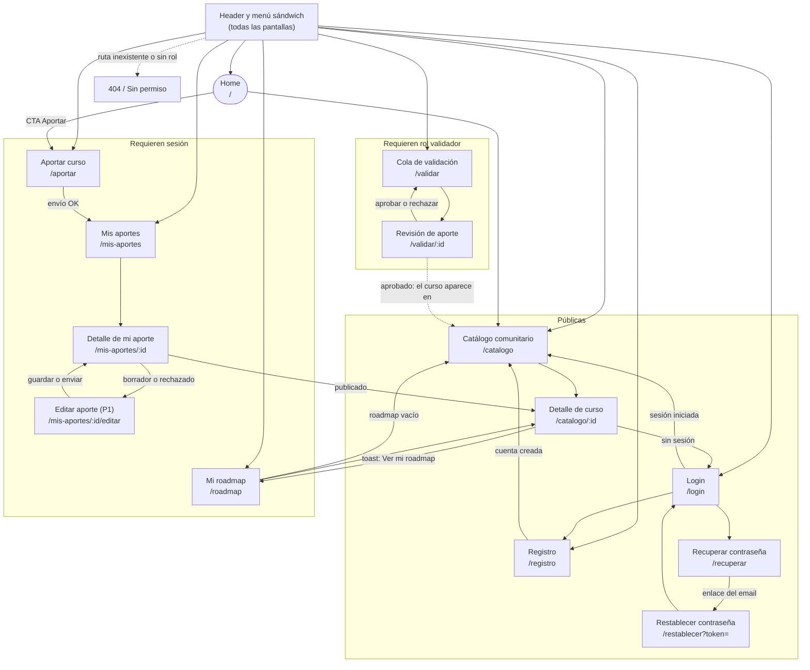
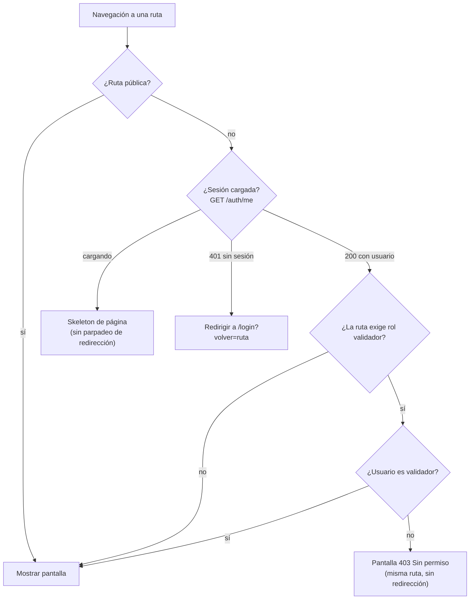

# APPFlow — Mapa del sitio y flujos de usuario — Roadmap de Cursos

> **Qué es:** el esqueleto de navegación. Sitemap (todas las pantallas y sus rutas), ficha por
> pantalla y flujos de usuario extremo a extremo. Es el puente entre el [PRD](PRD.md) (qué quiere el usuario)
> y el [BackendSchema](BackendSchema.md) (qué API lo sostiene).
> **Cuándo está bien:** se puede recorrer el producto entero en papel antes de escribir una línea
> de React; cada pantalla sabe qué API consume, y esas APIs existen en el BackendSchema;
> no hay ninguna pantalla "colgada" sin ruta ni ningún flujo sin pantallas.
> **Convención:** los endpoints se identifican como `EP-xx` (catálogo completo en el [Anexo A](#anexo-a--contrato-de-api-consumido-por-el-frontend));
> el BackendSchema conserva esos mismos identificadores y los códigos de error de [TRD §2.2](TRD.md#22-envelope-de-errores).

## 1. Sitemap

### Guarda de rutas

## 2. Rutas

| Ruta | Pantalla | Acceso | Notas |
|------|----------|--------|-------|
| `/` | Home | público | hero, 3 pasos y vista previa de los 6 últimos cursos (con enlace al catálogo paginado) |
| `/catalogo` | Catálogo comunitario (paginado) | público | query params: `q`, `categoria`, `page`; P1: `certificado`, `cuestionarios`, `examen`, `aval`, `idioma` |
| `/catalogo/:id` | Detalle de curso | público | 404 si no existe **o** no está publicado (BR-016) |
| `/login` | Login | público | `?volver=/ruta`; si ya hay sesión, redirige a `/catalogo` |
| `/registro` | Registro | público | si ya hay sesión, redirige a `/catalogo` |
| `/recuperar` | Solicitar recuperación de contraseña | público | |
| `/restablecer` | Restablecer contraseña | público | `?token=…` obligatorio; sin token o con token inválido muestra el error y enlace a `/recuperar` |
| `/roadmap` | Mi roadmap | sesión | redirect a `/login?volver=/roadmap` si no hay sesión |
| `/aportar` | Formulario de aporte | sesión | |
| `/mis-aportes` | Mis aportes (paginado) | sesión | más recientes primero |
| `/mis-aportes/:id` | Detalle de mi aporte | sesión (autor) | 404 si no es mío |
| `/mis-aportes/:id/editar` | Editar aporte (P1) | sesión (autor) | solo `borrador` o `rechazado`; otro estado → redirige al detalle con aviso |
| `/validar` | Cola de validación (paginada) | sesión + rol `validador` | más antiguos primero |
| `/validar/:id` | Revisión de un aporte | sesión + rol `validador` | |
| `*` | 404 | público | |

### 2.1 Navegación por rol (header ≥ 768 px y menú sándwich < 768 px)

| Ítem | Visitante | Usuario | Validador |
|------|:---------:|:-------:|:---------:|
| Catálogo | ✓ | ✓ | ✓ |
| Mi roadmap | — | ✓ | ✓ |
| Aportar curso | — (lleva a login) | ✓ | ✓ |
| Mis aportes | — | ✓ | ✓ |
| Validar | — | — | ✓ |
| Ingresar / Registrarse | ✓ | — | — |
| Cerrar sesión (menú de avatar o final del panel) | — | ✓ | ✓ |

## 3. Fichas de pantalla

> Una por cada pantalla del sitemap. Los estados `loading` / `ok` / `empty` / `error` siguen UX-UI §4.4 y §4.8.

### Shell de la app (header, menú sándwich, toasts, guardas)

- **Objetivo del usuario:** moverse por el producto con una mano y saber siempre dónde está.
- **Componentes (UX-UI):** header sticky, menú sándwich (§4.5), toast (§4.7), alerta global (§4.12), "Saltar al contenido".
- **Estados:** menú `cerrado` / `abierto` · sesión `cargando` / `anónima` / `autenticada` · banner de red `oculto` / `sin conexión`.
- **APIs que consume:** `EP-04` (sesión al iniciar la app y tras login/logout) · `EP-03` (cerrar sesión).
- **Navegación:** < 768 px, hamburguesa que abre el panel con los ítems de §2.1; ≥ 768 px, nav horizontal. Cierra con enlace, X, ESC o clic fuera. Cubre US-015.

### Pantalla: Home (`/`)

- **Objetivo del usuario:** entender qué es el producto en segundos y llegar al catálogo o aportar un curso.
- **Componentes (UX-UI):** hero, 3 pasos, grid de 6 cards, botones primario/secundario, skeleton.
- **Estados:** `loading` (6 skeletons) · `ok` · `empty` (sin cursos: se oculta la vista previa y queda el CTA "Aportá el primero") · `error` (se oculta la vista previa; el resto de la pantalla sigue funcionando).
- **APIs que consume:** `EP-08` con `page=1&page_size=6` (vista previa; el listado completo y paginado está en el catálogo).
- **Navegación:** → `/catalogo` (CTA y "Ver todo") · → `/catalogo/:id` (card) · → `/aportar` (CTA; sin sesión pasa por `/login`) · → `/registro`.

### Pantalla: Catálogo comunitario (`/catalogo`)

- **Objetivo del usuario:** encontrar un curso gratuito confiable buscando y filtrando. Cubre US-001, US-002, US-014.
- **Componentes (UX-UI):** header, buscador y filtros (§4.10), chips de filtros activos, grid de cards (§4.3), paginador (§4.4), empty state, skeleton.
- **Estados:** `loading` (skeleton de 12 cards; al paginar se mantiene la página anterior atenuada) · `ok` · `empty` (sin cursos publicados → "Aportá el primero"; con filtros → "Limpiar filtros") · `error` (mensaje + "Reintentar").
- **APIs que consume:** `EP-08` `GET /api/v1/cursos?page=…&page_size=12&q=…&categoria=…` (P1: `&certificado=…&cuestionarios=…&examen=…&aval=…&idioma=…`) · `EP-07` (opciones del filtro de categoría) · `EP-20` (botón "Agregar a mi roadmap" de la card).
- **Navegación:** desde Home y menú; → Detalle de curso; → `/aportar` (CTA del empty state). Cualquier cambio de filtro vuelve a `page=1` y se refleja en la URL. Sin sesión, "Agregar a mi roadmap" lleva a `/login?volver=…`.

### Pantalla: Detalle de curso (`/catalogo/:id`)

- **Objetivo del usuario:** decidir si el curso le sirve y, si sí, ir al sitio o sumarlo a su roadmap. Cubre US-003 y parte de US-010.
- **Componentes (UX-UI):** breadcrumb, `h1`, chips, lista de metadatos, atributos con texto, botón primario "Ir al curso", botón secundario "Agregar a mi roadmap", toast.
- **Estados:** `loading` (skeleton) · `ok` · `error` (reintentar) · **404** si el curso no existe o no está publicado (misma pantalla 404, sin revelar que existe).
- **APIs que consume:** `EP-09` · `EP-20` (agregar).
- **Navegación:** desde Catálogo, Home, Roadmap y Mis aportes (publicado); "Ir al curso" abre la URL externa en pestaña nueva con `rel="noopener noreferrer"`; tras agregar, toast con acción "Ver mi roadmap" → `/roadmap`; sin sesión → `/login?volver=/catalogo/:id`.

### Pantalla: Registro (`/registro`)

- **Objetivo del usuario:** crear una cuenta para aportar y armar su roadmap. Cubre US-004.
- **Componentes (UX-UI):** card centrada, campos nombre/email/contraseña (con mostrar/ocultar), botón primario, alerta (429), enlace a login.
- **Estados:** `default` · `error` por campo (`email_duplicado`, `validacion_fallida`) · `bloqueado` (429, con tiempo restante) · `enviando` (botón en `loading`) · éxito → redirección.
- **APIs que consume:** `EP-01`.
- **Navegación:** → `/catalogo` (o `volver`) tras el alta · → `/login`.

### Pantalla: Login (`/login`)

- **Objetivo del usuario:** iniciar sesión. Cubre US-005.
- **Componentes (UX-UI):** card centrada, campos email y contraseña, botón primario, alerta de error genérico y de rate limiting, enlaces a registro y recuperación.
- **Estados:** `default` · `error` (`credenciales_invalidas`: "Email o contraseña incorrectos") · `bloqueado` (`demasiados_intentos`: "Probá de nuevo en N minutos", formulario deshabilitado con cuenta regresiva) · `enviando`.
- **APIs que consume:** `EP-02` (luego `EP-04` para cargar el usuario).
- **Navegación:** → `volver` (si es una ruta interna válida) o `/catalogo` · → `/registro` · → `/recuperar`. `volver` solo se acepta si empieza con `/` y no con `//` (evita redirecciones abiertas).

### Pantalla: Recuperar contraseña (`/recuperar`)

- **Objetivo del usuario:** pedir el enlace para restablecer su contraseña. Cubre US-006.
- **Componentes (UX-UI):** card centrada, campo email, botón primario, alerta de confirmación y de rate limiting.
- **Estados:** `default` · `enviado` (mensaje idéntico exista o no la cuenta: "Si el email está registrado, te enviamos un enlace…") · `bloqueado` (429) · `enviando`.
- **APIs que consume:** `EP-05`.
- **Navegación:** → `/login`. El enlace del email lleva a `/restablecer?token=…` (en desarrollo, el correo se lee en Mailpit).

### Pantalla: Restablecer contraseña (`/restablecer`)

- **Objetivo del usuario:** definir una nueva contraseña con el token recibido. Cubre US-006.
- **Componentes (UX-UI):** card centrada, campos nueva contraseña y confirmación, botón primario, alerta de token inválido.
- **Estados:** `default` · `error` de validación (≥ 10 caracteres, confirmación igual) · `token_invalido` (token inexistente, vencido o usado: mensaje + botón "Pedir un enlace nuevo" → `/recuperar`) · `enviando` · éxito → toast y redirección a `/login`.
- **APIs que consume:** `EP-06`.
- **Navegación:** → `/login` tras restablecer (todas las sesiones anteriores quedan cerradas) · → `/recuperar`.

### Pantalla: Aportar curso (`/aportar`)

- **Objetivo del usuario:** cargar un curso gratuito con todos sus metadatos y enviarlo a revisión. Cubre US-007 (y el "Guardar borrador" de US-012, P1).
- **Componentes (UX-UI):** formulario en 3 cards (campos §4.2, radios sí/no, lista dinámica de docentes), resumen de errores, botones "Enviar a revisión" (primario) y "Guardar borrador" (secundario, P1), toast, alerta de duplicado.
- **Campos:** URL, categoría (lista cerrada), tema, título, versión, año de edición, docentes (1–10), plataforma, idioma, ¿cuestionarios?, ¿examen?, ¿certificado?, ¿aval? (+ organización si es sí), duración (opcional), descripción (opcional), "Tomé este curso: sí/no" y confirmación "El curso es gratuito" (RF-014).
- **Estados:** `default` · `error` por campo (límites de BR-011) · `error` de duplicado (`url_duplicada`) · `enviando` · éxito → redirección.
- **APIs que consume:** `EP-07` (categorías) · `EP-10` (envía con `enviar: true`, o `enviar: false` para borrador).
- **Navegación:** → `/mis-aportes` tras el envío (toast "Tu aporte está en revisión"). Salir con cambios sin guardar pide confirmación del navegador.

### Pantalla: Mis aportes (`/mis-aportes`)

- **Objetivo del usuario:** saber en qué estado está cada aporte. Cubre US-008.
- **Componentes (UX-UI):** lista/tabla paginada (§4.4), badges de estado (§4.9), botón primario "Aportar curso", empty state.
- **Estados:** `loading` · `ok` · `empty` ("Aportar mi primer curso") · `error`.
- **APIs que consume:** `EP-11` `GET /api/v1/aportes?page=…&page_size=12` (solo los del usuario de la sesión, más recientes primero; filtro opcional `estado`).
- **Navegación:** → `/mis-aportes/:id` · → `/aportar`.

### Pantalla: Detalle de mi aporte (`/mis-aportes/:id`)

- **Objetivo del usuario:** ver todos los datos de su aporte, su estado y el motivo si fue rechazado. Cubre US-008 y US-012.
- **Componentes (UX-UI):** `h1`, badge de estado, lista de metadatos, historial de decisiones (validador, fecha, resultado, motivo), botones según estado: "Editar" (borrador/rechazado, P1), "Enviar a revisión" (borrador, P1), "Ver en el catálogo" (publicado).
- **Estados:** `loading` · `ok` · `error` · 404 (no es mío o no existe).
- **APIs que consume:** `EP-12` · `EP-14` (enviar un borrador/rechazado, P1).
- **Navegación:** → `/mis-aportes/:id/editar` · → `/catalogo/:id` (publicado) · ← `/mis-aportes`.

### Pantalla: Editar aporte (`/mis-aportes/:id/editar`) — P1

- **Objetivo del usuario:** completar un borrador o corregir un aporte rechazado y volver a enviarlo. Cubre US-012.
- **Componentes (UX-UI):** el mismo formulario que "Aportar", precargado; alerta con el último motivo de rechazo; botones "Guardar borrador" (solo si es borrador) y "Enviar a revisión".
- **Estados:** `loading` · `default` · `error` por campo · `enviando` · `estado_invalido` (si el aporte ya no es editable → aviso y redirección al detalle).
- **APIs que consume:** `EP-12` (carga) · `EP-07` · `EP-13` (guarda cambios) · `EP-14` (envía a revisión).
- **Navegación:** → `/mis-aportes/:id` al guardar o enviar.

### Pantalla: Cola de validación (`/validar`)

- **Objetivo del usuario (validador):** ver qué hay para revisar y tomar el siguiente. Cubre US-009.
- **Componentes (UX-UI):** lista/tabla paginada con título, aportante, plataforma y fecha de envío; empty state.
- **Estados:** `loading` · `ok` · `empty` ("No hay aportes pendientes. ¡Buen trabajo!") · `error` · **403** si no es validador.
- **APIs que consume:** `EP-15` `GET /api/v1/validacion/cola?page=…&page_size=12` (más antiguos primero).
- **Navegación:** → `/validar/:id`.

### Pantalla: Revisión de aporte (`/validar/:id`)

- **Objetivo del usuario (validador):** verificar un aporte y aprobarlo o rechazarlo con criterio. Cubre US-009.
- **Componentes (UX-UI):** metadatos completos, botón "Abrir enlace del curso" (pestaña nueva), **checklist de 4 verificaciones** (§4.11), botón primario "Aprobar", botón peligro "Rechazar" (abre modal con el motivo, §4.6), toasts, alerta de conflicto.
- **Estados:** `loading` · `ok` · `propio` (el aporte es del propio validador: botones deshabilitados y aviso "No podés validar tus propios aportes") · `conflicto` (otro validador ya lo resolvió: aviso y vuelta a la cola) · `error` · 404.
- **APIs que consume:** `EP-16` (detalle para validar) · `EP-17` (aprobar, con las 4 verificaciones en `true`) · `EP-18` (rechazar, con `motivo` ≥ 10 caracteres).
- **Navegación:** → `/validar` tras resolver (toast "Aporte publicado" o "Aporte rechazado").

### Pantalla: Mi roadmap (`/roadmap`)

- **Objetivo del usuario:** ver y gestionar el orden y el progreso de sus cursos. Cubre US-011 y US-013.
- **Componentes (UX-UI):** lista/tabla paginada (§4.4), selector de progreso (§4.11), botones "Subir"/"Bajar" (P1), botón "Quitar" con modal de confirmación (§4.6), badge de progreso, empty state, toasts.
- **Estados:** `loading` · `ok` · `empty` ("Explorar el catálogo") · `error` · cambio de progreso optimista con reversión si falla.
- **APIs que consume:** `EP-19` `GET /api/v1/roadmap?page=…&page_size=12` · `EP-21` (progreso u orden) · `EP-22` (quitar).
- **Navegación:** → `/catalogo/:id` (título del curso) · → `/catalogo` (empty state).

### Pantalla: 404 y Sin permiso

- **Objetivo del usuario:** entender qué pasó y volver al camino.
- **Componentes (UX-UI):** empty state con icono, mensaje y CTA "Volver al catálogo".
- **Estados:** `404` (ruta inexistente o recurso no visible) · `403` (ruta de validador sin ese rol; se muestra en la misma URL).
- **APIs que consume:** ninguna.
- **Navegación:** → `/catalogo`.

## 4. Flujos de usuario

> Pasos numerados de punta a punta, incluyendo validaciones, errores y ramas alternativas.

### Flujo 1 — Registro y primeros pasos (US-004)

1. Una persona sin cuenta llega a `/registro` desde el header ("Registrarse"), la Home o el enlace del login.
2. El formulario pide **nombre** (2–60), **email** y **contraseña** (10–128, con botón mostrar/ocultar y la ayuda "Mínimo 10 caracteres").
3. Validación en línea al salir de cada campo y al enviar; si hay errores, el foco va al primero y se muestra el resumen.
4. Submit → `POST /api/v1/auth/registro` (`EP-01`) → **201** con el usuario (rol `usuario`) y `Set-Cookie: sid` (sesión iniciada).
5. La app refresca la sesión (`EP-04`), muestra el toast "¡Bienvenido/a, *nombre*!" y redirige a `volver` o a `/catalogo`.
6. **Ramas de error:** `409 email_duplicado` → error junto al email ("Ese email ya está registrado" con enlace a login) · `422 validacion_fallida` → `details` mapeados campo por campo · `429 demasiados_intentos` → alerta con el tiempo restante y botón deshabilitado · error de red → toast de error y el formulario conserva lo escrito.
7. **Rama alternativa:** si ya hay sesión y entra a `/registro`, redirige a `/catalogo`.

### Flujo 2 — Login, sesión y cierre de sesión (US-005)

1. Una persona intenta abrir una ruta protegida (por ejemplo `/aportar`) sin sesión: la guarda la lleva a `/login?volver=/aportar`. (O entra directo a `/login`.)
2. Ingresa email y contraseña → `POST /api/v1/auth/login` (`EP-02`).
3. **200:** cookie `sid`, la app carga el usuario (`EP-04`) y redirige a `volver` (solo rutas internas) o a `/catalogo`.
4. **Ramas de error:** `401 credenciales_invalidas` → "Email o contraseña incorrectos" (no dice cuál falló) · `429 demasiados_intentos` (5 fallidos por email+IP o 20 por IP en 15 min) → formulario deshabilitado con "Probá de nuevo en N minutos" según `Retry-After`.
5. Con la sesión activa, cada request lleva la cookie. Si una request protegida devuelve `401 no_autenticado` (sesión vencida), la app muestra el toast "Tu sesión expiró. Ingresá de nuevo.", limpia la caché y redirige a `/login?volver=<ruta actual>`.
6. **Cierre de sesión:** el usuario elige "Cerrar sesión" → `POST /api/v1/auth/logout` (`EP-03`) → 204; la app limpia la caché de TanStack Query y vuelve a `/catalogo`. El botón "Atrás" no muestra datos protegidos (se revalidan con `EP-04`).

### Flujo 3 — Recuperación de contraseña (US-006)

1. En `/login`, la persona elige "¿Olvidaste tu contraseña?" → `/recuperar`.
2. Ingresa su email → `POST /api/v1/auth/recuperacion` (`EP-05`) → **202** con el **mismo mensaje exista o no la cuenta**: "Si el email está registrado, te enviamos un enlace. Vence en 30 minutos."
3. Si la cuenta existe, el backend envía un correo con `FRONTEND_BASE_URL/restablecer?token=…` (en desarrollo, visible en Mailpit `http://localhost:8025`).
4. La persona abre el enlace → `/restablecer?token=…` e ingresa la nueva contraseña (≥ 10 caracteres) y su confirmación.
5. Submit → `POST /api/v1/auth/restablecimiento` (`EP-06`) → **204**: el token queda invalidado y **todas las sesiones previas se cierran**.
6. La app muestra el toast "Contraseña actualizada" y redirige a `/login`; la persona entra con la nueva contraseña (la anterior ya no funciona).
7. **Ramas de error:** `400 token_invalido` (inexistente, vencido o ya usado) → mensaje y botón "Pedir un enlace nuevo" · `422 validacion_fallida` → errores por campo · `429 demasiados_intentos` en el paso 2 (3/h por email, 10/h por IP) → alerta con el tiempo restante.

### Flujo 4 — Aportar un curso al catálogo (US-007)

1. Una persona con sesión elige "Aportar curso" (header, menú, Home o empty states) y llega a `/aportar`. Sin sesión: `/login?volver=/aportar`.
2. El formulario pide, en tres bloques: **(1)** URL, categoría (lista), tema, título, versión, año de edición, plataforma, idioma; **(2)** docentes (1–10), ¿cuestionarios?, ¿examen?, ¿certificado?, ¿aval? (con organización si es sí), duración y descripción opcionales; **(3)** "Tomé este curso: sí/no" y la confirmación "El curso es gratuito". Ningún sí/no viene preseleccionado.
3. **Validaciones en línea (cliente, espejadas en el servidor):** obligatorios; URL `http/https` ≤ 2048; título 5–200; tema 3–120; año entre 2000 y el año en curso; docentes de 2–120 caracteres; aval → organización obligatoria; gratuidad confirmada.
4. Submit "Enviar a revisión" → `POST /api/v1/aportes` (`EP-10`) con `enviar: true` → **201** con `{ id, estado: "en_revision" }`.
5. Toast "Tu aporte está en revisión" y redirección a `/mis-aportes`, donde aparece primero con el badge "En revisión".
6. El curso **no** aparece en el catálogo público hasta que un validador lo apruebe (BR-001).
7. **Ramas de error:** `422 validacion_fallida` → mensajes por campo, **nada se pierde** · `409 url_duplicada` → alerta bajo el campo URL: si `meta.estado = "publicado"`, con enlace a `/catalogo/{meta.curso_id}` ("Ese curso ya está en el catálogo: agregalo a tu roadmap"); si es `en_revision`, "Ese enlace ya está en revisión" · error de red → toast de error y se puede reintentar.
8. **Rama alternativa (P1):** "Guardar borrador" → `POST /api/v1/aportes` con `enviar: false` (solo el título es obligatorio) → **201** `estado: "borrador"`, toast "Borrador guardado" y redirección a `/mis-aportes`.

### Flujo 5 — Validación de un aporte (US-009)

1. Una persona con rol `validador` entra a `/validar` (ítem "Validar" del menú) → `GET /api/v1/validacion/cola` (`EP-15`): lista paginada de aportes `en_revision`, del más antiguo al más nuevo. Si el usuario no es validador, ve la pantalla 403.
2. Elige un aporte → `/validar/:id` → `GET /api/v1/validacion/aportes/{id}` (`EP-16`): ve todos los datos, quién lo aportó y si declaró haberlo tomado.
3. Abre el enlace del curso (pestaña nueva) y completa el **checklist de 4 verificaciones**: enlace activo · realmente gratuito · datos coinciden · categoría correcta.
4. **Aprobar:** habilitado solo con las 4 marcadas → `POST /api/v1/validacion/aportes/{id}/aprobar` (`EP-17`) con las verificaciones en `true` → **200**: el curso pasa a `publicado` y se registra la decisión (validador, fecha, resultado). Toast "Aporte publicado" y vuelta a la cola.
5. **Rechazar:** botón "Rechazar" abre un modal que exige un **motivo de al menos 10 caracteres** → `POST /api/v1/validacion/aportes/{id}/rechazar` (`EP-18`) → **200**: pasa a `rechazado`, el motivo queda registrado y visible para el autor. Toast "Aporte rechazado" y vuelta a la cola.
6. **Ramas de error:** `403 aporte_propio` (el aporte es del propio validador; la UI ya deshabilita los botones y explica por qué) · `409 estado_invalido` (otro validador lo resolvió antes) → aviso "Este aporte ya fue resuelto" y la cola se refresca · `422 validacion_fallida` (motivo corto o verificaciones incompletas) · `404 no_encontrado` · `401 no_autenticado` → flujo 2, paso 5.
7. **Efecto en el resto del producto:** el curso aprobado aparece en `/catalogo` y en la vista previa de la Home; el autor lo ve como "Publicado" en `/mis-aportes`.

### Flujo 6 — Descubrir un curso y agregarlo a mi roadmap (US-001, US-002, US-003, US-010)

1. Cualquier persona entra a `/catalogo` (desde Home o menú) → `GET /api/v1/cursos?page=1&page_size=12` (`EP-08`) y `GET /api/v1/categorias` (`EP-07`).
2. Busca por texto y/o elige una categoría; la lista se actualiza, vuelve a la página 1 y la URL refleja el estado (`?q=python&categoria=1&page=1`).
3. Cambia de página con el paginador sin recargar; el total se mantiene visible.
4. Abre una card → `/catalogo/:id` (`EP-09`) y revisa metadatos, aval, certificado, examen y si el aportante lo tomó.
5. Presiona "Agregar a mi roadmap" (en la card o en el detalle): **con sesión** → `POST /api/v1/roadmap/items` (`EP-20`) con `{ curso_id }` → **201** (progreso `pendiente`, al final del orden); el botón pasa a "En tu roadmap ✓" y aparece el toast con acción "Ver mi roadmap".
6. **Sin sesión:** el botón lleva a `/login?volver=/catalogo/:id`; tras autenticarse vuelve al curso para completar la acción.
7. **Ramas de error:** `409 ya_en_roadmap` → el botón se sincroniza a "En tu roadmap ✓" · `404 no_encontrado` (el curso ya no está publicado) → aviso y se refresca el listado · red → toast con reintento.
8. **Sin resultados:** empty state "No encontramos cursos con esos filtros" con "Limpiar filtros".
9. **Rama P1:** con los filtros por atributos (certificado, examen, cuestionarios, aval, idioma) el paso 2 se amplía con `certificado=true`, `examen=false`, etc.

### Flujo 7 — Gestionar mi roadmap (US-011, US-013)

1. La persona con sesión entra a `/roadmap` → `GET /api/v1/roadmap?page=1&page_size=12` (`EP-19`): sus cursos ordenados por posición, con progreso.
2. **Cambiar progreso:** elige `pendiente`, `en curso` o `completado` en el selector → `PATCH /api/v1/roadmap/items/{id}` (`EP-21`) con `{ progreso }` → **200**; la UI lo muestra al instante (optimista) y confirma con el toast "Progreso actualizado". Si falla, se revierte y se informa.
3. **Reordenar (P1):** "Subir"/"Bajar" → `PATCH /api/v1/roadmap/items/{id}` con `{ orden }` (nueva posición global, 1-based) → **200**; la lista se refresca; el primer ítem no puede subir ni el último bajar (botones deshabilitados).
4. **Quitar:** "Quitar" → modal de confirmación → `DELETE /api/v1/roadmap/items/{id}` (`EP-22`) → **204**; el curso sale del roadmap y permanece en el catálogo; si la página queda vacía, se retrocede una.
5. **Roadmap vacío:** empty state "Tu roadmap está vacío" con CTA "Explorar el catálogo" → `/catalogo`.
6. **Ramas de error:** `404 no_encontrado` (el ítem no es del usuario o ya no existe: nunca se revela el roadmap ajeno) · `401 no_autenticado` → flujo 2, paso 5 · red → toast con reintento.

### Flujo 8 — Corregir un aporte rechazado y reenviarlo (P1, US-012)

1. En `/mis-aportes` la persona ve un aporte con el badge "Rechazado" y abre `/mis-aportes/:id` (`EP-12`): se muestra el motivo y el historial de decisiones.
2. Elige "Editar" → `/mis-aportes/:id/editar` con el formulario precargado y la alerta con el último motivo.
3. Corrige los datos y presiona "Enviar a revisión" → `PUT /api/v1/aportes/{id}` (`EP-13`) y luego `POST /api/v1/aportes/{id}/enviar` (`EP-14`) → **200** con `estado: "en_revision"`; se aplica la validación completa y el chequeo de URL duplicada.
4. Toast "Tu aporte está nuevamente en revisión" y vuelta a `/mis-aportes/:id`; el historial conserva los motivos de rechazos anteriores.
5. **Ramas de error:** `409 estado_invalido` (el aporte ya no es editable, por ejemplo está `en_revision` o `publicado`) → aviso y redirección al detalle · `409 url_duplicada` (alguien más envió ese enlace mientras tanto) · `422 validacion_fallida`.
6. **Mismo camino para un borrador (Flujo 4, paso 8):** se completa, se envía y pasa a `en_revision`.

## 5. Estados globales de la app

| Situación | Comportamiento |
|-----------|----------------|
| Sin sesión y ruta protegida | guarda de rutas: redirect a `/login?volver=<ruta original>` (solo rutas internas); mientras se resuelve `EP-04` se muestra un skeleton de página, no una redirección intermedia |
| Sesión expirada (`401 no_autenticado` en una request protegida) | toast "Tu sesión expiró. Ingresá de nuevo." + limpieza de la caché + redirect a `/login?volver=…` |
| Ruta de validador sin ese rol (`403 sin_permiso`) | pantalla 403 "No tenés permiso para ver esto" en la misma URL, con CTA al catálogo |
| Ruta o recurso inexistente / no visible (`404 no_encontrado`) | pantalla 404 con CTA al catálogo (igual para "no existe" y "no es tuyo/no está publicado") |
| Error de red global (`fetch` falla o `navigator.onLine = false`) | banner de alerta "Sin conexión" con "Reintentar" (reconsulta las queries activas); los formularios conservan lo escrito |
| Rate limiting (`429 demasiados_intentos`) | alerta junto al formulario con el tiempo restante (`Retry-After`); el botón se deshabilita hasta que corra la cuenta regresiva |
| Error del servidor (`500 error_interno`) | estado `error` en la pantalla con "Reintentar" y el código de referencia (`request_id`) para soporte; nunca se muestra el detalle técnico |
| Error de render no controlado | *error boundary* de la app: pantalla de error con "Recargar" |
| Salir de un formulario con cambios sin guardar | confirmación del navegador (formularios de aporte) |
| Origen no permitido (`403 origen_no_permitido`) | toast de error genérico; se registra en el log (no debería ocurrir en uso normal) |

## Anexo A — Contrato de API consumido por el frontend

> Estos son los endpoints que las pantallas necesitan. El [BackendSchema](BackendSchema.md) debe especificar **cada uno** con
> su request, respuestas y errores, conservando el identificador `EP-xx`. Prefijo `/api/v1` (salvo `EP-23`).
> `público*` = no exige sesión, pero si hay sesión agrega `en_mi_roadmap` y `roadmap_item_id` a cada curso.

| EP | Método | Path | Acceso | Historia | Pantallas |
|----|--------|------|--------|----------|-----------|
| EP-01 | POST | `/auth/registro` | público | US-004 | Registro |
| EP-02 | POST | `/auth/login` | público | US-005 | Login |
| EP-03 | POST | `/auth/logout` | sesión | US-005 | Shell |
| EP-04 | GET | `/auth/me` | sesión (401 = anónimo) | US-005 | Shell, guardas |
| EP-05 | POST | `/auth/recuperacion` | público | US-006 | Recuperar |
| EP-06 | POST | `/auth/restablecimiento` | público | US-006 | Restablecer |
| EP-07 | GET | `/categorias` | público | US-002, US-007 | Catálogo, Aportar, Editar |
| EP-08 | GET | `/cursos` (`page`, `page_size`, `q`, `categoria`, P1: `certificado`, `cuestionarios`, `examen`, `aval`, `idioma`) | público* | US-001, US-002, US-014 | Home, Catálogo |
| EP-09 | GET | `/cursos/{id}` | público* | US-003 | Detalle de curso |
| EP-10 | POST | `/aportes` (campo `enviar`: `true` por defecto; `false` = borrador, P1) | sesión | US-007, US-012 | Aportar |
| EP-11 | GET | `/aportes` (`page`, `page_size`, `estado`) | sesión | US-008 | Mis aportes |
| EP-12 | GET | `/aportes/{id}` (incluye historial de validaciones) | sesión (autor) | US-008, US-012 | Detalle de mi aporte, Editar |
| EP-13 | PUT | `/aportes/{id}` | sesión (autor) | US-012 (P1) | Editar |
| EP-14 | POST | `/aportes/{id}/enviar` | sesión (autor) | US-012 (P1) | Detalle de mi aporte, Editar |
| EP-15 | GET | `/validacion/cola` (`page`, `page_size`) | rol validador | US-009 | Cola de validación |
| EP-16 | GET | `/validacion/aportes/{id}` | rol validador | US-009 | Revisión |
| EP-17 | POST | `/validacion/aportes/{id}/aprobar` (body: las 4 verificaciones, todas `true`) | rol validador | US-009 | Revisión |
| EP-18 | POST | `/validacion/aportes/{id}/rechazar` (body: `motivo` ≥ 10 caracteres) | rol validador | US-009 | Revisión |
| EP-19 | GET | `/roadmap` (`page`, `page_size`) | sesión | US-011 | Roadmap |
| EP-20 | POST | `/roadmap/items` (body: `curso_id`) | sesión | US-010 | Catálogo, Detalle de curso |
| EP-21 | PATCH | `/roadmap/items/{id}` (body: `progreso` y/o `orden`) | sesión | US-011, US-013 | Roadmap |
| EP-22 | DELETE | `/roadmap/items/{id}` | sesión | US-011 | Roadmap |
| EP-23 | GET | `/health` (sin prefijo `/api/v1`) | público | RNF-008 | infra (M0) |

## Anexo B — Cobertura de historias del PRD por pantalla y flujo

| Historia | Prioridad | Pantallas | Flujo |
|----------|-----------|-----------|-------|
| US-001 | P0 | Home, Catálogo | 6 |
| US-002 | P0 | Catálogo | 6 |
| US-003 | P0 | Detalle de curso | 6 |
| US-004 | P0 | Registro | 1 |
| US-005 | P0 | Login, Shell | 2 |
| US-006 | P0 | Recuperar, Restablecer | 3 |
| US-007 | P0 | Aportar | 4 |
| US-008 | P0 | Mis aportes, Detalle de mi aporte | 4, 8 |
| US-009 | P0 | Cola de validación, Revisión | 5 |
| US-010 | P0 | Catálogo, Detalle de curso | 6 |
| US-011 | P0 | Roadmap | 7 |
| US-012 | P1 | Aportar, Detalle de mi aporte, Editar aporte | 4 (paso 8), 8 |
| US-013 | P1 | Roadmap | 7 (paso 3) |
| US-014 | P1 | Catálogo | 6 (paso 9) |
| US-015 | P0 | Shell | — (componente global; ver ficha del Shell) |

---

**Referencias:**
- NN/g — Information Architecture vs. Sitemaps: https://www.nngroup.com/articles/information-architecture-sitemaps/
- NN/g — User Journeys vs. User Flows: https://www.nngroup.com/articles/user-journeys-vs-user-flows/
