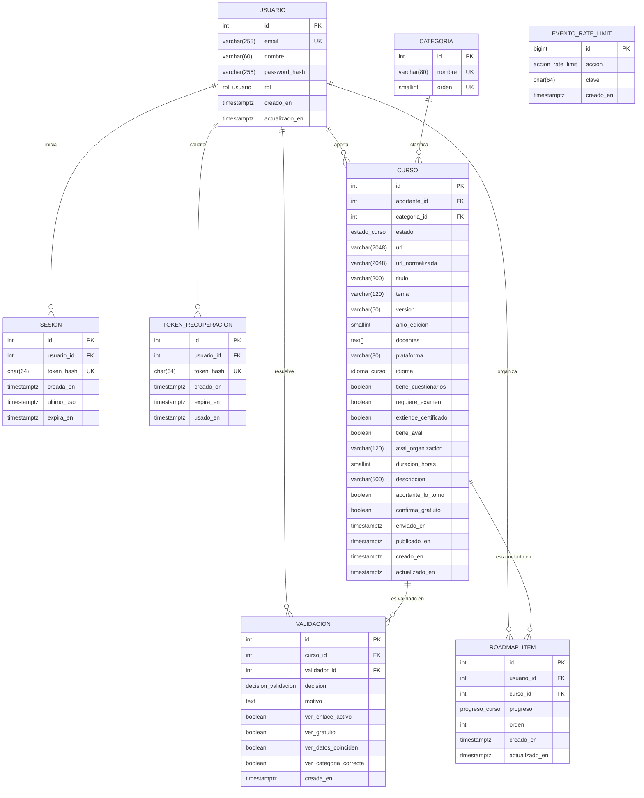
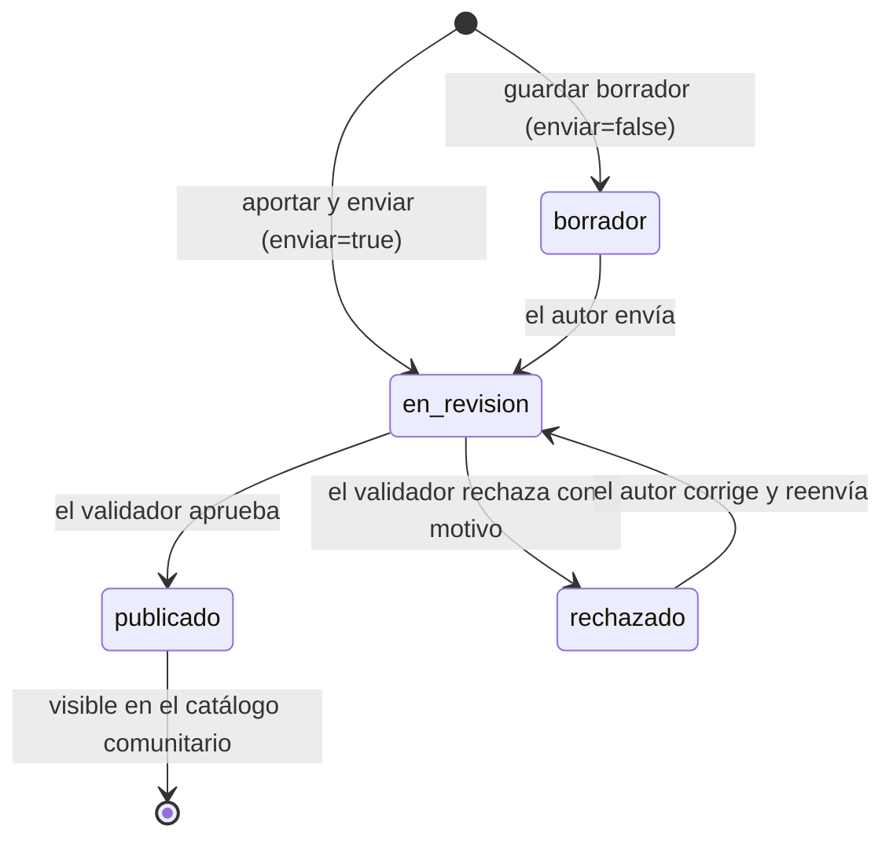

# BackendSchema — Esquema de base de datos y APIs — Roadmap de Cursos

> **Qué es:** el contrato del backend: modelo de datos en PostgreSQL 18.6 + superficie de API REST.
> Es lo que hace posible el [TRD](TRD.md) y lo que consume el [APPFlow](APPFlow.md).
> **Cuándo está bien:** con este documento se puede crear la base de datos y escribir los tests
> de integración sin tomar decisiones de diseño pendientes; todo endpoint que aparece en el
> APPFlow existe acá con sus respuestas y errores (conserva los identificadores `EP-xx` del
> [APPFlow Anexo A](APPFlow.md#anexo-a--contrato-de-api-consumido-por-el-frontend)); los estados del curso están modelados.
> **Reglas de origen:** cada restricción cita su regla del [PRD §7](PRD.md#7-reglas-de-negocio) (`BR-xxx`).

## 1. Modelo de datos

### 1.1 Diagrama entidad-relación (Mermaid — se renderiza en GitHub)



> `EVENTO_RATE_LIMIT` no tiene claves foráneas a propósito: su `clave` es un hash (email+IP / IP / email), no un usuario, y la tabla es descartable.
> **Un "aporte" no es una tabla aparte:** es un `CURSO` en su ciclo de vida (`estado`). El catálogo comunitario son los cursos con `estado = 'publicado'`.

### 1.2 Tipos enumerados

| Tipo | Valores | Uso |
|------|---------|-----|
| `rol_usuario` | `usuario`, `validador` | `usuarios.rol` (BR-007) |
| `estado_curso` | `borrador`, `en_revision`, `publicado`, `rechazado` | `cursos.estado` (BR-009) |
| `idioma_curso` | `es`, `en`, `pt`, `otro` | `cursos.idioma` (BR-011) |
| `decision_validacion` | `aprobado`, `rechazado` | `validaciones.decision` |
| `progreso_curso` | `pendiente`, `en_curso`, `completado` | `roadmap_items.progreso` (BR-006) |
| `accion_rate_limit` | `login_fallido_email_ip`, `login_fallido_ip`, `recuperacion_email`, `recuperacion_ip`, `registro_ip` | `eventos_rate_limit.accion` (BR-012) |

### 1.3 Tablas (una por entidad)

> Convenciones: identificadores `integer GENERATED ALWAYS AS IDENTITY` (TD-011); fechas `timestamptz` en UTC; nombres en español, `snake_case`.
> Restricción `CHECK` con columna `NULL` **pasa** (semántica SQL): la obligatoriedad se expresa con `NOT NULL` o con el `CHECK` de completitud de `cursos`.

#### `usuarios`

| Columna | Tipo | Constraints | Notas |
|---------|------|-------------|-------|
| id | integer | PK, identity | |
| email | varchar(255) | NOT NULL, UNIQUE, `CHECK (email = lower(email))` | normalizado (trim + minúsculas) **antes** de guardar: así la unicidad no distingue mayúsculas (RF-001) |
| nombre | varchar(60) | NOT NULL, `CHECK (char_length(nombre) BETWEEN 2 AND 60)` | nombre de pantalla público (BR-013) |
| password_hash | varchar(255) | NOT NULL | argon2id (`$argon2id$…`); nunca la contraseña en claro (RF-007) |
| rol | rol_usuario | NOT NULL, default `'usuario'` | |
| creado_en / actualizado_en | timestamptz | NOT NULL, default `now()` | |

**Índices:** el UNIQUE de `email` sirve a la búsqueda de login. Sin otros: ≤ 500 usuarios.

#### `sesiones`

| Columna | Tipo | Constraints | Notas |
|---------|------|-------------|-------|
| id | integer | PK, identity | |
| usuario_id | integer | NOT NULL, FK → usuarios `ON DELETE CASCADE` | |
| token_hash | char(64) | NOT NULL, UNIQUE | SHA-256 (hex) del identificador de 256 bits de la cookie `sid` (TD-001) |
| creada_en | timestamptz | NOT NULL, default `now()` | |
| ultimo_uso | timestamptz | NOT NULL, default `now()` | vencimiento por inactividad: `ultimo_uso + 7 días`; se renueva como máximo 1 vez por hora |
| expira_en | timestamptz | NOT NULL | vencimiento absoluto: `creada_en + 30 días` |

**Índices:** `ix_sesiones_usuario (usuario_id)` — cerrar todas las sesiones al restablecer la contraseña; `ix_sesiones_ultimo_uso (ultimo_uso)` — limpieza.

#### `tokens_recuperacion`

| Columna | Tipo | Constraints | Notas |
|---------|------|-------------|-------|
| id | integer | PK, identity | |
| usuario_id | integer | NOT NULL, FK → usuarios `ON DELETE CASCADE` | |
| token_hash | char(64) | NOT NULL, UNIQUE | SHA-256 del token enviado por email (el token en claro no se guarda) |
| creado_en | timestamptz | NOT NULL, default `now()` | |
| expira_en | timestamptz | NOT NULL | `creado_en + 30 min` (BR-012) |
| usado_en | timestamptz | NULL | no nulo = ya consumido (un solo uso) |

**Índices:** `ix_tokens_usuario (usuario_id)`. Al pedir un token nuevo se invalidan (marcan usados) los pendientes del mismo usuario.

#### `eventos_rate_limit`

| Columna | Tipo | Constraints | Notas |
|---------|------|-------------|-------|
| id | bigint | PK, identity | |
| accion | accion_rate_limit | NOT NULL | qué se limita (§1.2) |
| clave | char(64) | NOT NULL | SHA-256 de `email_normalizado\|ip`, de `ip` o de `email_normalizado` según la acción: **no se guardan emails ni IPs en claro** |
| creado_en | timestamptz | NOT NULL, default `now()` | |

**Índices:** `ix_rate_limit_busqueda (accion, clave, creado_en DESC)` — conteo por ventana. **Limpieza:** se borran filas con más de 24 h.
**Conteo:** `SELECT count(*) FROM eventos_rate_limit WHERE accion = :a AND clave = :k AND creado_en > now() - :ventana`.

#### `categorias`

| Columna | Tipo | Constraints | Notas |
|---------|------|-------------|-------|
| id | integer | PK, identity | |
| nombre | varchar(80) | NOT NULL, UNIQUE | lista cerrada de 10 (PRD Anexo A), cargada por seed |
| orden | smallint | NOT NULL, UNIQUE | orden de aparición en los selects |

#### `cursos` (aporte + catálogo)

| Columna | Tipo | Constraints | Notas |
|---------|------|-------------|-------|
| id | integer | PK, identity | |
| aportante_id | integer | NOT NULL, FK → usuarios `ON DELETE RESTRICT` | quien lo aporta (BR-013); la baja de cuentas está fuera de alcance |
| estado | estado_curso | NOT NULL, default `'borrador'` | ciclo de vida (§2) |
| categoria_id | integer | FK → categorias | NULL solo en `borrador` |
| url | varchar(2048) | `CHECK (url ~* '^https?://')` | enlace web activo, tal como lo cargó el autor |
| url_normalizada | varchar(2048) | | resultado de `aportes/url.py` (§4.2); base de la unicidad BR-004 |
| titulo | varchar(200) | NOT NULL, `CHECK (char_length(titulo) BETWEEN 5 AND 200)` | **único campo obligatorio de un `borrador`** |
| tema | varchar(120) | `CHECK (char_length(tema) BETWEEN 3 AND 120)` | |
| version | varchar(50) | `CHECK (char_length(version) BETWEEN 1 AND 50)` | texto libre ("2025", "v3") |
| anio_edicion | smallint | `CHECK (anio_edicion BETWEEN 2000 AND 2100)` | el tope "≤ año en curso" lo valida el service (la BD no puede usar `now()` en un CHECK inmutable) |
| docentes | text[] | `CHECK (cardinality(docentes) BETWEEN 1 AND 10)` | cada elemento 2–120 caracteres: lo valida el service |
| plataforma | varchar(80) | `CHECK (char_length(plataforma) BETWEEN 2 AND 80)` | "Coursera", "YouTube", … |
| idioma | idioma_curso | | |
| tiene_cuestionarios | boolean | | sin default: la elección es explícita (BR-011) |
| requiere_examen | boolean | | |
| extiende_certificado | boolean | | |
| tiene_aval | boolean | | |
| aval_organizacion | varchar(120) | `CHECK (aval_organizacion IS NULL OR char_length(aval_organizacion) BETWEEN 2 AND 120)` | |
| duracion_horas | smallint | `CHECK (duracion_horas BETWEEN 1 AND 2000)` | opcional |
| descripcion | varchar(500) | | opcional |
| aportante_lo_tomo | boolean | | declaración de toma (BR-002); NULL solo en `borrador` |
| confirma_gratuito | boolean | | confirmación de gratuidad (BR-003); debe ser `true` fuera de `borrador` |
| enviado_en | timestamptz | | último envío a revisión; ordena la cola |
| publicado_en | timestamptz | | se fija al aprobar; ordena el catálogo |
| creado_en / actualizado_en | timestamptz | NOT NULL, default `now()` | |

**Constraints de tabla:**

| Nombre | Regla | Origen |
|--------|-------|--------|
| `ck_cursos_completo_si_no_borrador` | si `estado <> 'borrador'`: `url`, `url_normalizada`, `categoria_id`, `tema`, `version`, `anio_edicion`, `docentes`, `plataforma`, `idioma`, las 4 banderas, `aportante_lo_tomo` y `enviado_en` son `NOT NULL` y `confirma_gratuito IS TRUE` | BR-002, BR-003, BR-009, BR-011 |
| `ck_cursos_aval_coherente` | `(tiene_aval IS TRUE AND aval_organizacion IS NOT NULL) OR (tiene_aval IS NOT TRUE AND aval_organizacion IS NULL)` | BR-011 |
| `ck_cursos_publicado_en` | `(estado = 'publicado') = (publicado_en IS NOT NULL)` | BR-009 |
| `uq_cursos_url_activa` | índice **único parcial** sobre `url_normalizada` `WHERE estado IN ('en_revision','publicado')` | BR-004 |

**Índices:**

| Índice | Definición | Para qué |
|--------|------------|----------|
| `ix_cursos_catalogo` | `(publicado_en DESC, id DESC) WHERE estado = 'publicado'` | listado del catálogo (EP-08) en orden determinístico (TD-002) |
| `ix_cursos_cola` | `(enviado_en ASC, id ASC) WHERE estado = 'en_revision'` | cola de validación (EP-15) |
| `ix_cursos_aportante` | `(aportante_id, creado_en DESC, id DESC)` | "Mis aportes" (EP-11) |
| `ix_cursos_categoria` | `(categoria_id) WHERE estado = 'publicado'` | filtro por categoría |

> La búsqueda de texto (`q`) no lleva índice en esta versión (TD-007): scan secuencial sobre los publicados.

#### `validaciones` (auditoría, BR-014)

| Columna | Tipo | Constraints | Notas |
|---------|------|-------------|-------|
| id | integer | PK, identity | |
| curso_id | integer | NOT NULL, FK → cursos `ON DELETE RESTRICT` | |
| validador_id | integer | NOT NULL, FK → usuarios `ON DELETE RESTRICT` | |
| decision | decision_validacion | NOT NULL | |
| motivo | text | | obligatorio si `rechazado` |
| ver_enlace_activo | boolean | | las 4 verificaciones del checklist (BR-008); obligatorias y `true` si `aprobado` |
| ver_gratuito | boolean | | |
| ver_datos_coinciden | boolean | | |
| ver_categoria_correcta | boolean | | |
| creada_en | timestamptz | NOT NULL, default `now()` | |

**Constraints:** `ck_validaciones_aprobado` (`decision <> 'aprobado' OR (ver_enlace_activo AND ver_gratuito AND ver_datos_coinciden AND ver_categoria_correcta)`) · `ck_validaciones_rechazado` (`decision <> 'rechazado' OR (motivo IS NOT NULL AND char_length(btrim(motivo)) >= 10)`).
**Inmutabilidad:** un trigger `BEFORE UPDATE OR DELETE` lanza excepción (la tabla es un registro de auditoría).
**Índices:** `ix_validaciones_curso (curso_id, creada_en DESC)`.

#### `roadmap_items`

| Columna | Tipo | Constraints | Notas |
|---------|------|-------------|-------|
| id | integer | PK, identity | |
| usuario_id | integer | NOT NULL, FK → usuarios `ON DELETE CASCADE` | dueño del roadmap (BR-005) |
| curso_id | integer | NOT NULL, FK → cursos `ON DELETE RESTRICT` | solo cursos publicados (lo valida el service) |
| progreso | progreso_curso | NOT NULL, default `'pendiente'` | BR-006 |
| orden | integer | NOT NULL, `CHECK (orden >= 1)` | posición global dentro del roadmap, contigua 1..N |
| creado_en / actualizado_en | timestamptz | NOT NULL, default `now()` | |

**Constraints:** `uq_roadmap_usuario_curso UNIQUE (usuario_id, curso_id)` (BR-006) · `uq_roadmap_usuario_orden UNIQUE (usuario_id, orden) DEFERRABLE INITIALLY DEFERRED` (permite reordenar dentro de una transacción, TD-004).
**Índices:** los dos UNIQUE cubren las consultas por `usuario_id` ordenadas por `orden`.

### 1.4 DDL de referencia (lo que materializan las migraciones de Alembic)

> Las tablas simples (`sesiones`, `tokens_recuperacion`, `eventos_rate_limit`, `categorias`) siguen directamente las tablas de §1.3.
> Se muestra el DDL de lo no trivial: tipos, `usuarios`, `cursos`, `validaciones` y `roadmap_items`.

```sql
CREATE EXTENSION IF NOT EXISTS unaccent;

CREATE TYPE rol_usuario         AS ENUM ('usuario', 'validador');
CREATE TYPE estado_curso        AS ENUM ('borrador', 'en_revision', 'publicado', 'rechazado');
CREATE TYPE idioma_curso        AS ENUM ('es', 'en', 'pt', 'otro');
CREATE TYPE decision_validacion AS ENUM ('aprobado', 'rechazado');
CREATE TYPE progreso_curso      AS ENUM ('pendiente', 'en_curso', 'completado');
CREATE TYPE accion_rate_limit   AS ENUM ('login_fallido_email_ip', 'login_fallido_ip',
                                         'recuperacion_email', 'recuperacion_ip', 'registro_ip');

CREATE TABLE usuarios (
  id             integer GENERATED ALWAYS AS IDENTITY PRIMARY KEY,
  email          varchar(255) NOT NULL,
  nombre         varchar(60)  NOT NULL,
  password_hash  varchar(255) NOT NULL,
  rol            rol_usuario  NOT NULL DEFAULT 'usuario',
  creado_en      timestamptz  NOT NULL DEFAULT now(),
  actualizado_en timestamptz  NOT NULL DEFAULT now(),
  CONSTRAINT uq_usuarios_email UNIQUE (email),
  CONSTRAINT ck_usuarios_email_minuscula CHECK (email = lower(email)),
  CONSTRAINT ck_usuarios_nombre_largo CHECK (char_length(nombre) BETWEEN 2 AND 60)
);

CREATE TABLE cursos (
  id                   integer GENERATED ALWAYS AS IDENTITY PRIMARY KEY,
  aportante_id         integer       NOT NULL REFERENCES usuarios(id) ON DELETE RESTRICT,
  estado               estado_curso  NOT NULL DEFAULT 'borrador',
  categoria_id         integer       REFERENCES categorias(id),
  url                  varchar(2048),
  url_normalizada      varchar(2048),
  titulo               varchar(200)  NOT NULL,
  tema                 varchar(120),
  version              varchar(50),
  anio_edicion         smallint,
  docentes             text[],
  plataforma           varchar(80),
  idioma               idioma_curso,
  tiene_cuestionarios  boolean,
  requiere_examen      boolean,
  extiende_certificado boolean,
  tiene_aval           boolean,
  aval_organizacion    varchar(120),
  duracion_horas       smallint,
  descripcion          varchar(500),
  aportante_lo_tomo    boolean,
  confirma_gratuito    boolean,
  enviado_en           timestamptz,
  publicado_en         timestamptz,
  creado_en            timestamptz   NOT NULL DEFAULT now(),
  actualizado_en       timestamptz   NOT NULL DEFAULT now(),
  CONSTRAINT ck_cursos_url_formato CHECK (url ~* '^https?://'),
  CONSTRAINT ck_cursos_titulo_largo CHECK (char_length(titulo) BETWEEN 5 AND 200),
  CONSTRAINT ck_cursos_tema_largo CHECK (char_length(tema) BETWEEN 3 AND 120),
  CONSTRAINT ck_cursos_version_largo CHECK (char_length(version) BETWEEN 1 AND 50),
  CONSTRAINT ck_cursos_anio CHECK (anio_edicion BETWEEN 2000 AND 2100),
  CONSTRAINT ck_cursos_docentes CHECK (cardinality(docentes) BETWEEN 1 AND 10),
  CONSTRAINT ck_cursos_plataforma_largo CHECK (char_length(plataforma) BETWEEN 2 AND 80),
  CONSTRAINT ck_cursos_duracion CHECK (duracion_horas BETWEEN 1 AND 2000),
  CONSTRAINT ck_cursos_aval_coherente CHECK (
    (tiene_aval IS TRUE AND aval_organizacion IS NOT NULL AND char_length(aval_organizacion) BETWEEN 2 AND 120)
    OR (tiene_aval IS NOT TRUE AND aval_organizacion IS NULL)),
  CONSTRAINT ck_cursos_publicado_en CHECK ((estado = 'publicado') = (publicado_en IS NOT NULL)),
  CONSTRAINT ck_cursos_completo_si_no_borrador CHECK (
    estado = 'borrador' OR (
      url IS NOT NULL AND url_normalizada IS NOT NULL AND categoria_id IS NOT NULL
      AND tema IS NOT NULL AND version IS NOT NULL AND anio_edicion IS NOT NULL
      AND docentes IS NOT NULL AND plataforma IS NOT NULL AND idioma IS NOT NULL
      AND tiene_cuestionarios IS NOT NULL AND requiere_examen IS NOT NULL
      AND extiende_certificado IS NOT NULL AND tiene_aval IS NOT NULL
      AND aportante_lo_tomo IS NOT NULL AND confirma_gratuito IS TRUE
      AND enviado_en IS NOT NULL))
);

CREATE UNIQUE INDEX uq_cursos_url_activa ON cursos (url_normalizada)
  WHERE estado IN ('en_revision', 'publicado');
CREATE INDEX ix_cursos_catalogo  ON cursos (publicado_en DESC, id DESC) WHERE estado = 'publicado';
CREATE INDEX ix_cursos_cola      ON cursos (enviado_en ASC, id ASC)     WHERE estado = 'en_revision';
CREATE INDEX ix_cursos_aportante ON cursos (aportante_id, creado_en DESC, id DESC);
CREATE INDEX ix_cursos_categoria ON cursos (categoria_id)               WHERE estado = 'publicado';

CREATE TABLE validaciones (
  id                      integer GENERATED ALWAYS AS IDENTITY PRIMARY KEY,
  curso_id                integer NOT NULL REFERENCES cursos(id)   ON DELETE RESTRICT,
  validador_id            integer NOT NULL REFERENCES usuarios(id) ON DELETE RESTRICT,
  decision                decision_validacion NOT NULL,
  motivo                  text,
  ver_enlace_activo       boolean,
  ver_gratuito            boolean,
  ver_datos_coinciden     boolean,
  ver_categoria_correcta  boolean,
  creada_en               timestamptz NOT NULL DEFAULT now(),
  CONSTRAINT ck_validaciones_aprobado CHECK (
    decision <> 'aprobado' OR (ver_enlace_activo AND ver_gratuito
                               AND ver_datos_coinciden AND ver_categoria_correcta)),
  CONSTRAINT ck_validaciones_rechazado CHECK (
    decision <> 'rechazado' OR (motivo IS NOT NULL AND char_length(btrim(motivo)) >= 10))
);
CREATE INDEX ix_validaciones_curso ON validaciones (curso_id, creada_en DESC);

CREATE FUNCTION validaciones_inmutable() RETURNS trigger AS $$
BEGIN
  RAISE EXCEPTION 'validaciones es un registro de auditoría: no se modifica ni se borra';
END;
$$ LANGUAGE plpgsql;
CREATE TRIGGER trg_validaciones_inmutable BEFORE UPDATE OR DELETE ON validaciones
  FOR EACH ROW EXECUTE FUNCTION validaciones_inmutable();

CREATE TABLE roadmap_items (
  id             integer GENERATED ALWAYS AS IDENTITY PRIMARY KEY,
  usuario_id     integer NOT NULL REFERENCES usuarios(id) ON DELETE CASCADE,
  curso_id       integer NOT NULL REFERENCES cursos(id)   ON DELETE RESTRICT,
  progreso       progreso_curso NOT NULL DEFAULT 'pendiente',
  orden          integer NOT NULL,
  creado_en      timestamptz NOT NULL DEFAULT now(),
  actualizado_en timestamptz NOT NULL DEFAULT now(),
  CONSTRAINT uq_roadmap_usuario_curso UNIQUE (usuario_id, curso_id),
  CONSTRAINT uq_roadmap_usuario_orden UNIQUE (usuario_id, orden) DEFERRABLE INITIALLY DEFERRED,
  CONSTRAINT ck_roadmap_orden_positivo CHECK (orden >= 1)
);
```

### 1.5 Migraciones y datos semilla

| Migración (Alembic) | Contenido | Módulo / tarea |
|---------------------|-----------|----------------|
| `0001_extension_unaccent` | extensión `unaccent` | M0 · 0.5 |
| `0002_identidad` | `rol_usuario`, `accion_rate_limit`, `usuarios`, `sesiones`, `tokens_recuperacion`, `eventos_rate_limit` | M1 · 1.1 |
| `0003_categorias_y_cursos` | `estado_curso`, `idioma_curso`, `categorias`, `cursos`, constraints e índices | M2 · 2.1 |
| `0004_validaciones` | `decision_validacion`, `validaciones`, trigger de inmutabilidad | M3 · 3.1 |
| `0005_roadmap` | `progreso_curso`, `roadmap_items` | M4 · 4.1 |

Los datos semilla **no** viajan en migraciones: son comandos idempotentes que el backend ejecuta al arrancar.

| Seed | Contenido | Cuándo |
|------|-----------|--------|
| Categorías | las 10 del PRD Anexo A, en ese orden (`upsert` por nombre) | siempre |
| Validador inicial | un usuario con rol `validador` creado desde `SEED_VALIDADOR_*` si no existe | si las variables están definidas |
| Demo (`seed-demo`) | 3 usuarios de prueba y ≥ 30 cursos `publicado` de ≥ 5 plataformas y ≥ 6 categorías (para ver 3 páginas), más aportes `en_revision` para la cola | solo `APP_ENV=dev`, manual |

## 2. Estados del ciclo de vida del curso



| Estado | Quién lo ve | Qué puede pasar |
|--------|-------------|-----------------|
| `borrador` | solo el autor (BR-016) | editar (campos parciales), enviar a revisión |
| `en_revision` | autor + validadores | un validador (que no sea el autor) aprueba o rechaza; no se edita |
| `publicado` | todos (incluso sin sesión) | se incluye en roadmaps; inmutable en esta versión |
| `rechazado` | autor + validadores | el autor ve el motivo, edita (datos completos) y reenvía |

**Transiciones permitidas** (cualquier otra → `409 estado_invalido`):

| Desde → Hacia | Quién | Endpoint | Condiciones | Efectos |
|---------------|-------|----------|-------------|---------|
| ∅ → `en_revision` | autor | EP-10 (`enviar=true`) | datos completos (BR-011), URL no duplicada (BR-004) | `enviado_en = now()` |
| ∅ → `borrador` | autor | EP-10 (`enviar=false`) | solo `titulo` | — |
| `borrador` → `en_revision` | autor | EP-14 | datos completos, URL no duplicada | `enviado_en = now()` |
| `rechazado` → `en_revision` | autor | EP-14 | datos completos, URL no duplicada | `enviado_en = now()` (vuelve al final de la cola) |
| `en_revision` → `publicado` | validador ≠ autor | EP-17 | las 4 verificaciones en `true` | `publicado_en = now()` + fila en `validaciones` |
| `en_revision` → `rechazado` | validador ≠ autor | EP-18 | `motivo` ≥ 10 caracteres | fila en `validaciones` |

> Garantías: el `UPDATE` de aprobación/rechazo es **condicional** (`WHERE estado = 'en_revision'`); si afecta 0 filas, otro validador ya resolvió → `409`. Un `CHECK` de la tabla impide estados incoherentes (p. ej. `publicado` sin `publicado_en`).

## 3. API REST

**Convención general:**

- Prefijo: `/api/v1` (salvo `EP-23`). Formato JSON UTF-8; `Content-Type: application/json` obligatorio en métodos no seguros (TRD §2.4). Todas las respuestas llevan `X-Request-ID`.
- Timestamps en ISO 8601 UTC (`2026-10-23T20:15:00Z`).
- **Paginación** (TD-002, BR-015): offset — `?page=1&page_size=12` (`page ≥ 1`, `1 ≤ page_size ≤ 50`) con respuesta `{ "items": [...], "total": N, "page": n, "page_size": n }`. Una página mayor a la última devuelve `200` con `items: []`. Orden siempre determinístico con desempate por `id`.
  - *Única excepción de defecto:* `GET /categorias` usa `page_size` por defecto **50** (lista cerrada de 10 opciones para un `select`), con el mismo envelope.
- **Errores** (TD-003): `{ "error": { "code", "message", "details"?, "meta"?, "request_id" } }` con los códigos de [TRD §2.2](TRD.md#22-envelope-de-errores). Las tablas siguientes listan los códigos que cada endpoint puede devolver.
- **Autenticación:** sesión por cookie `sid` (`HttpOnly`, `SameSite=Lax`). "sesión" = usuario autenticado; "rol validador" = además `rol = 'validador'`.
- **Orden de evaluación** de un request: formato/tipos (FastAPI → `422`) → sesión (`401`) → rol (`403 sin_permiso`) → rate limiting (`429`) → existencia y visibilidad (`404`) → reglas de negocio (`403 aporte_propio`, `409`, `422` de negocio).
- **Documentación interactiva:** `GET /docs` (OpenAPI) solo con `APP_ENV=dev`.

### 3.0 Objetos de la API

**Usuario**

```json
{ "id": 7, "nombre": "Lucía Pérez", "email": "lucia@example.com", "rol": "usuario" }
```

**Categoría:** `{ "id": 3, "nombre": "Ciberseguridad y redes" }`

**CursoResumen** (items de EP-08; `en_mi_roadmap` y `roadmap_item_id` son `null` si no hay sesión)

```json
{
  "id": 42,
  "titulo": "Introducción a Python",
  "categoria": { "id": 1, "nombre": "Programación y desarrollo" },
  "tema": "Python básico",
  "plataforma": "freeCodeCamp",
  "version": "2025",
  "anio_edicion": 2025,
  "docentes": ["Ana Gómez", "Luis Pardo"],
  "idioma": "es",
  "tiene_cuestionarios": true,
  "requiere_examen": false,
  "extiende_certificado": true,
  "tiene_aval": true,
  "aval_organizacion": "Universidad Nacional de La Plata",
  "aportante": { "nombre": "Lucía Pérez" },
  "aportante_lo_tomo": true,
  "publicado_en": "2026-10-20T15:02:11Z",
  "en_mi_roadmap": false,
  "roadmap_item_id": null
}
```

**CursoDetalle** (EP-09) = CursoResumen + `url` (enlace externo), `duracion_horas` (opcional) y `descripcion` (opcional).

**AporteIn** (cuerpo de EP-10 y EP-13)

| Campo | Tipo | Regla |
|-------|------|-------|
| `url` | string | http/https, ≤ 2048 |
| `categoria_id` | integer | debe existir |
| `titulo` | string | 5–200 (**único obligatorio si `enviar=false`**) |
| `tema` | string | 3–120 |
| `version` | string | 1–50 |
| `anio_edicion` | integer | 2000 a año en curso |
| `docentes` | string[] | 1–10 elementos, cada uno 2–120 |
| `plataforma` | string | 2–80 |
| `idioma` | `"es"｜"en"｜"pt"｜"otro"` | |
| `tiene_cuestionarios`, `requiere_examen`, `extiende_certificado`, `tiene_aval` | boolean | sin valor por defecto |
| `aval_organizacion` | string | 2–120; obligatorio si `tiene_aval = true`, debe ser `null` si es `false` |
| `duracion_horas` | integer | opcional, 1–2000 |
| `descripcion` | string | opcional, ≤ 500 |
| `aportante_lo_tomo` | boolean | declaración de toma (BR-002) |
| `confirma_gratuito` | boolean | debe ser `true` (BR-003) |
| `enviar` | boolean | solo EP-10; defecto `true` |

Códigos de `details[].code` en `422 validacion_fallida`: `requerido`, `muy_corto`, `muy_largo`, `formato_invalido`, `fuera_de_rango`, `valor_invalido`, `sin_elementos`, `demasiados_elementos`, `categoria_inexistente`, `debe_ser_verdadero`, `verificaciones_incompletas`.

**AporteResumen** (items de EP-11): `{ "id", "titulo", "estado", "plataforma", "creado_en", "enviado_en", "ultimo_motivo_rechazo" }` (`plataforma`, `enviado_en` y `ultimo_motivo_rechazo` pueden ser `null`).

**AporteDetalle** (EP-12) = todos los campos de AporteIn (sin `enviar`; `url_normalizada` no se expone) + `id`, `estado`, `categoria {id, nombre}`, `creado_en`, `actualizado_en`, `enviado_en`, `publicado_en` y `validaciones: [{ "decision", "motivo", "creada_en" }]` (historial completo, más reciente primero; **sin identidad del validador**).

**ColaItem** (EP-15): `{ "id", "titulo", "plataforma", "aportante": { "id", "nombre" }, "enviado_en", "es_propio" }`.

**AporteRevision** (EP-16) = AporteDetalle + `aportante { id, nombre }`, `es_propio` y cada elemento de `validaciones` con `validador { id, nombre }`.

**RoadmapItem**

```json
{
  "id": 9, "orden": 1, "progreso": "en_curso", "agregado_en": "2026-10-21T18:30:00Z",
  "curso": { "id": 42, "titulo": "Introducción a Python", "categoria": { "id": 1, "nombre": "Programación y desarrollo" },
             "plataforma": "freeCodeCamp", "version": "2025", "anio_edicion": 2025, "idioma": "es",
             "tiene_cuestionarios": true, "requiere_examen": false, "extiende_certificado": true, "tiene_aval": true }
}
```

### 3.1 Autenticación (M1)

| EP | Método | Path | Auth | Request | Respuestas |
|----|--------|------|------|---------|------------|
| EP-01 | POST | `/api/v1/auth/registro` | pública | `{ "nombre": "...", "email": "...", "password": "..." }` | **201** `{ "usuario": Usuario }` + `Set-Cookie: sid` (sesión iniciada) · **409** `email_duplicado` · **422** `validacion_fallida` (nombre 2–60, email válido, password 10–128) · **429** `demasiados_intentos` (10/h por IP) |
| EP-02 | POST | `/api/v1/auth/login` | pública | `{ "email": "...", "password": "..." }` | **200** `{ "usuario": Usuario }` + `Set-Cookie: sid` · **401** `credenciales_invalidas` · **422** · **429** `demasiados_intentos` (5 fallidos email+IP / 20 por IP en 15 min, con `Retry-After`) |
| EP-03 | POST | `/api/v1/auth/logout` | sesión | — | **204** y la cookie se invalida (idempotente: sin sesión también responde 204) |
| EP-04 | GET | `/api/v1/auth/me` | sesión | — | **200** `{ "usuario": Usuario }` · **401** `no_autenticado` (el frontend lo interpreta como "anónimo") |
| EP-05 | POST | `/api/v1/auth/recuperacion` | pública | `{ "email": "..." }` | **202** `{ "mensaje": "Si el email está registrado, te enviamos un enlace. Vence en 30 minutos." }` (idéntico exista o no la cuenta) · **422** (formato de email) · **429** (3/h por email, 10/h por IP) |
| EP-06 | POST | `/api/v1/auth/restablecimiento` | pública | `{ "token": "...", "password": "..." }` | **204** (token consumido y **todas las sesiones del usuario eliminadas**; no inicia sesión) · **400** `token_invalido` (inexistente, vencido o usado) · **422** (password 10–128) |

Notas: la comparación de credenciales verifica contra un hash señuelo si el email no existe (tiempos similares). El login exitoso borra los `login_fallido_email_ip` de esa clave. El email de EP-05 contiene `FRONTEND_BASE_URL/restablecer?token=<token>`; el token en claro nunca se guarda.

### 3.2 Categorías y catálogo de cursos (M2)

| EP | Método | Path | Auth | Query / Request | Respuestas |
|----|--------|------|------|-----------------|------------|
| EP-07 | GET | `/api/v1/categorias` | pública | `page`, `page_size` (defecto 50) | **200** Page de Categoría (10 items, en `orden`) · **422** |
| EP-08 | GET | `/api/v1/cursos` | pública (con sesión agrega `en_mi_roadmap`) | `page`, `page_size`, `q`, `categoria`, y P1: `certificado`, `cuestionarios`, `examen`, `aval`, `idioma` | **200** Page de CursoResumen · **422** |
| EP-09 | GET | `/api/v1/cursos/{id}` | pública (idem) | — | **200** CursoDetalle · **404** `no_encontrado` (no existe **o** no está publicado: BR-016) |

**Parámetros de EP-08:**

| Parámetro | Tipo | Semántica |
|-----------|------|-----------|
| `q` | string (≤ 100) | se parte en hasta 5 palabras; **cada palabra** debe aparecer (coincidencia parcial, sin mayúsculas ni tildes) en título, tema o docentes; `%`, `_` y `\` se escapan; vacío = sin filtro |
| `categoria` | integer ≥ 1 | id de categoría; inexistente → lista vacía (no error) |
| `certificado` | boolean | `true` → `extiende_certificado = true`; `false` → `= false` |
| `cuestionarios` | boolean | sobre `tiene_cuestionarios` |
| `examen` | boolean | sobre `requiere_examen` (`false` = "sin examen") |
| `aval` | boolean | sobre `tiene_aval` |
| `idioma` | `es｜en｜pt｜otro` | sobre `idioma` |

Los filtros se combinan con AND; los omitidos no filtran. Orden fijo: `publicado_en DESC, id DESC`. **Solo** devuelve `estado = 'publicado'`.

Ejemplo `GET /api/v1/cursos?page=1&page_size=2&q=pyth%C3%B3n&categoria=1` → 200:

```json
{
  "items": [
    { "id": 42, "titulo": "Introducción a Python", "categoria": {"id": 1, "nombre": "Programación y desarrollo"}, "plataforma": "freeCodeCamp", "...": "…" }
  ],
  "total": 14,
  "page": 1,
  "page_size": 2
}
```

### 3.3 Aportes de cursos (M3)

> Todos exigen sesión. Un aporte ajeno **no existe** para quien consulta: `404 no_encontrado` (nunca 403, BR-016).

| EP | Método | Path | Request | Respuestas |
|----|--------|------|---------|------------|
| EP-10 | POST | `/api/v1/aportes` | AporteIn (`enviar` defecto `true`) | **201** `{ "id": 15, "estado": "en_revision" }` (o `"borrador"` si `enviar=false`) + `Location: /api/v1/aportes/15` · **409** `url_duplicada` (solo si `enviar=true`; `meta: { "curso_id", "estado" }`) · **422** `validacion_fallida` |
| EP-11 | GET | `/api/v1/aportes` | `page`, `page_size`, `estado` (opcional) | **200** Page de AporteResumen (solo los del usuario; `creado_en DESC, id DESC`) · **422** |
| EP-12 | GET | `/api/v1/aportes/{id}` | — | **200** AporteDetalle · **404** (no existe o no es del usuario) |
| EP-13 | PUT | `/api/v1/aportes/{id}` | AporteIn sin `enviar` (reemplaza los campos editables) | **200** AporteDetalle · **404** · **409** `estado_invalido` (solo se edita `borrador` o `rechazado`, BR-010) · **422** (en `borrador` se admiten parciales con `titulo`; en `rechazado` se exigen datos completos porque el estado no cambia) |
| EP-14 | POST | `/api/v1/aportes/{id}/enviar` | — | **200** `{ "id": 15, "estado": "en_revision" }` · **404** · **409** `estado_invalido` (no es `borrador` ni `rechazado`) · **409** `url_duplicada` · **422** (datos incompletos o inválidos; `details` por campo) |

Ejemplo de error — `POST /api/v1/aportes` con año inválido → 422:

```json
{ "error": { "code": "validacion_fallida", "message": "Hay campos con errores.",
             "details": [ { "field": "anio_edicion", "code": "fuera_de_rango", "message": "El año debe estar entre 2000 y 2026." },
                          { "field": "aval_organizacion", "code": "requerido", "message": "Indicá la organización que avala el curso." } ],
             "request_id": "01JBX7Q2M5N9V3K8T4R6W1Z0YH" } }
```

### 3.4 Validación de aportes — rol validador (M3)

> Sin sesión → `401 no_autenticado`; con sesión pero sin rol validador → `403 sin_permiso`.

| EP | Método | Path | Request | Respuestas |
|----|--------|------|---------|------------|
| EP-15 | GET | `/api/v1/validacion/cola` | `page`, `page_size` | **200** Page de ColaItem (solo `en_revision`; `enviado_en ASC, id ASC`; incluye los propios con `es_propio: true`) · **422** |
| EP-16 | GET | `/api/v1/validacion/aportes/{id}` | — | **200** AporteRevision (cursos en `en_revision`, `publicado` o `rechazado`) · **404** (inexistente o `borrador`) |
| EP-17 | POST | `/api/v1/validacion/aportes/{id}/aprobar` | `{ "verificaciones": { "enlace_activo": true, "gratuito": true, "datos_coinciden": true, "categoria_correcta": true } }` | **200** `{ "id": 15, "estado": "publicado", "publicado_en": "…" }` · **403** `aporte_propio` · **404** · **409** `estado_invalido` (ya no está `en_revision`) · **422** `validacion_fallida` con `details[].code = verificaciones_incompletas` (alguna falta o es `false`) |
| EP-18 | POST | `/api/v1/validacion/aportes/{id}/rechazar` | `{ "motivo": "..." }` (10–1000 caracteres, sin contar espacios de los extremos) | **200** `{ "id": 15, "estado": "rechazado" }` · **403** `aporte_propio` · **404** · **409** `estado_invalido` · **422** (`motivo` muy corto o vacío) |

**Efectos de EP-17 / EP-18** (una sola transacción): `UPDATE cursos SET estado = …, publicado_en = … WHERE id = :id AND estado = 'en_revision'` (0 filas → `409`) + `INSERT` en `validaciones` (validador, decisión, motivo, verificaciones). Un validador **nunca** resuelve su propio aporte (BR-007): se verifica `curso.aportante_id <> validador.id` antes de modificar.

### 3.5 Roadmap del usuario (M4)

> Todos exigen sesión. Cada consulta filtra por el `usuario_id` de la sesión: el roadmap ajeno no existe (`404`).

| EP | Método | Path | Request | Respuestas |
|----|--------|------|---------|------------|
| EP-19 | GET | `/api/v1/roadmap` | `page`, `page_size` | **200** Page de RoadmapItem (`orden ASC`) · **422** |
| EP-20 | POST | `/api/v1/roadmap/items` | `{ "curso_id": 42 }` | **201** RoadmapItem (`progreso: "pendiente"`, `orden` = último + 1) · **404** `no_encontrado` (el curso no existe o no está publicado) · **409** `ya_en_roadmap` · **422** |
| EP-21 | PATCH | `/api/v1/roadmap/items/{id}` | `{ "progreso": "completado" }` y/o `{ "orden": 1 }` (al menos uno) | **200** RoadmapItem · **404** · **422** (`progreso` inválido, `orden` fuera de 1..N con `fuera_de_rango`, o cuerpo vacío) |
| EP-22 | DELETE | `/api/v1/roadmap/items/{id}` | — | **204** (se cierra el hueco: los posteriores bajan una posición) · **404** |

**Operaciones sobre `orden`** (siempre dentro de una transacción que bloquea la fila del usuario con `SELECT … FROM usuarios WHERE id = :u FOR UPDATE`, para serializar operaciones concurrentes del mismo roadmap):

- **Agregar:** `orden = coalesce(max(orden), 0) + 1` del usuario.
- **Mover del lugar `k` al lugar `n`:** si `n < k` → `orden = orden + 1` donde `n ≤ orden < k`; si `n > k` → `orden = orden - 1` donde `k < orden ≤ n`; luego el ítem pasa a `n`. El `UNIQUE (usuario_id, orden)` es diferido, así que se valida recién al `COMMIT`.
- **Quitar el lugar `k`:** se borra y `orden = orden - 1` donde `orden > k`.

### 3.6 Infraestructura (M0)

| EP | Método | Path | Auth | Respuestas |
|----|--------|------|------|------------|
| EP-23 | GET | `/health` | pública (sin prefijo `/api/v1`) | **200** `{ "status": "ok", "db": "ok" }` · **503** `{ "status": "degraded", "db": "error" }` si no hay conexión con PostgreSQL |

## 4. Decisiones del esquema

### 4.1 Tabla de decisiones

| Decisión | Alternativas | Por qué |
|----------|--------------|---------|
| Un solo `cursos` con `estado` (el "aporte" es un curso en su ciclo de vida) | tabla `aportes` + tabla `cursos` publicados | una sola entidad evita copiar datos al aprobar y garantiza que un curso publicado es exactamente lo que se revisó; la visibilidad se resuelve con `estado` |
| Categorías como tabla (FK) | `ENUM` de PostgreSQL | la lista es de negocio, no de código: se ajusta con un seed sin migrar tipos, y permite ordenar y consultar |
| Roadmap como tabla intermedia `roadmap_items` con `orden` y `progreso` | arreglo de ids en `usuarios` · copiar el curso | integridad referencial, unicidad por usuario y progreso/orden como atributos de la relación (TD-004) |
| `orden` único y diferido por usuario | `orden` con huecos (10, 20, 30) · lista enlazada | posiciones contiguas 1..N simples de paginar y de mostrar; el `DEFERRABLE` permite reordenar en una transacción |
| Banderas como `boolean` nullable | JSONB de atributos · tabla de atributos | son 4 atributos fijos y filtrables; `NULL` solo existe en borrador y lo prohíbe el `CHECK` de completitud |
| `docentes` como `text[]` | tabla `curso_docentes` | solo se muestran y se buscan como texto; no hay entidad "docente" con identidad propia (fuera de alcance) |
| Borrador con columnas nullable + `CHECK` condicional | tabla de borradores aparte · exigir todo siempre | un único modelo; la BD garantiza que nada incompleto salga de `borrador` |
| Unicidad de URL con índice único **parcial** | `UNIQUE` total · solo validación en el service | `rechazado` y `borrador` no bloquean la URL (BR-004) y la BD resuelve las carreras entre dos envíos simultáneos |
| `validaciones` como tabla de auditoría inmutable (trigger) | solo guardar el último motivo en `cursos` | conserva el historial entre rechazos y reenvíos (US-012, BR-014) y quién decidió |
| Verificaciones del checklist como 4 columnas `boolean` | JSONB | el checklist es fijo y se consulta/audita; un `CHECK` exige las 4 en `true` al aprobar |
| `ENUM` nativos de PostgreSQL | `varchar` + `CHECK` | valores cerrados y estables que el motor valida y ordena; sumar un valor es una migración simple |
| Tokens (sesión y recuperación) guardados como SHA-256 | guardarlos en claro | una filtración de la BD no entrega credenciales utilizables (TD-001) |
| `eventos_rate_limit` con `clave` hasheada y sin FKs | guardar email e IP en claro · en memoria | no almacena datos personales y es descartable (TD-006) |
| Emails guardados en minúsculas con `CHECK` | extensión `citext` | unicidad sin distinguir mayúsculas sin sumar otra extensión |
| Sin borrado lógico (`deleted_at`) | soft delete | no existen flujos de baja en esta versión: cursos publicados inmutables, validaciones inmutables, cuentas sin baja |
| `ON DELETE`: `CASCADE` en sesiones, tokens y roadmap del usuario; `RESTRICT` en cursos y validaciones | `CASCADE` en todo | lo personal se va con el usuario; el catálogo y la auditoría nunca se borran por accidente |
| `categorias` paginada con envelope y `page_size` 50 | respuesta sin paginar | mantiene la SPEC ("toda consulta de listado paginada") y un único parser en el frontend, sin trocear una lista de 10 opciones |

### 4.2 Normalización de URL (BR-004)

`url_normalizada` se calcula en `aportes/url.py`, siempre a partir de `url`; dos URLs con la misma forma normalizada son el mismo curso.

1. Esquema y host en minúsculas; se quita el puerto por defecto (`:80` en http, `:443` en https).
2. Se elimina el fragmento (`#…`).
3. Se eliminan los parámetros de seguimiento `utm_*`, `fbclid`, `gclid`, `mc_cid` y `mc_eid`; los restantes se ordenan alfabéticamente por clave.
4. Se quita la barra final del *path* (incluida la raíz). Mayúsculas del *path* y de los valores **se conservan** (son significativas).
5. No se elimina el prefijo `www.` ni se sigue ninguna redirección: dos hosts distintos se consideran cursos distintos (el validador detecta el resto).

| URL cargada | `url_normalizada` |
|-------------|-------------------|
| `HTTPS://Example.COM/Curso/?utm_source=x&id=7#top` | `https://example.com/Curso?id=7` |
| `https://example.com:443/` | `https://example.com` |
| `http://example.com/a?b=2&a=1` | `http://example.com/a?a=1&b=2` |
| `https://example.com/a/b/` | `https://example.com/a/b` |
| `https://www.example.com/a` | `https://www.example.com/a` (distinto de `https://example.com/a`) |

### 4.3 Reglas que garantiza el service (la BD no puede)

| Regla | Dónde se verifica | Test que la cubre |
|-------|-------------------|-------------------|
| Transiciones de estado válidas (BR-009) y edición solo en `borrador`/`rechazado` (BR-010) | `aportes/service.py` + `UPDATE … WHERE estado = …` | unit (tabla de transiciones) + integración |
| Un validador no resuelve su propio aporte (BR-007) | `aportes/validacion_service.py` | unit + integración (`403 aporte_propio`) |
| `anio_edicion` ≤ año en curso; elementos de `docentes` de 2–120 caracteres | schemas Pydantic de `aportes` | unit de schemas |
| Solo se agregan al roadmap cursos publicados (BR-005) | `roadmap/service.py` (usa el service de `catalogo`) | integración |
| Un curso no publicado es invisible fuera del autor/validadores (BR-016) | consultas del repository filtran por `estado` y rol | integración (404) |
| Orden contiguo 1..N del roadmap tras agregar, mover y quitar | `roadmap/service.py` | unit + integración |
| Rate limiting antes de verificar credenciales | `identidad/service.py` | integración (6.º fallido → 429) |

### 4.4 Consultas críticas

**Listado del catálogo con búsqueda** (TD-007):

```sql
SELECT c.*
FROM cursos c
WHERE c.estado = 'publicado'
  AND (:categoria IS NULL OR c.categoria_id = :categoria)
  -- por cada palabra p del texto buscado (AND entre palabras, OR entre campos):
  AND (unaccent(c.titulo) ILIKE unaccent(:p) ESCAPE '\'
       OR unaccent(c.tema) ILIKE unaccent(:p) ESCAPE '\'
       OR unaccent(array_to_string(c.docentes, ' ')) ILIKE unaccent(:p) ESCAPE '\')
ORDER BY c.publicado_en DESC, c.id DESC
LIMIT :page_size OFFSET (:page - 1) * :page_size;
-- :p = '%' || palabra_con_comodines_escapados || '%' ; el total sale de un COUNT(*) con los mismos filtros
```

**Resolución concurrente de un aporte** (aprobar):

```sql
UPDATE cursos
   SET estado = 'publicado', publicado_en = now(), actualizado_en = now()
 WHERE id = :id AND estado = 'en_revision' AND aportante_id <> :validador_id;
-- 0 filas afectadas → el service distingue: aporte propio (403) · ya resuelto (409 estado_invalido)
-- 1 fila → INSERT INTO validaciones (...) en la misma transacción
```

---

**Referencias:**
- Mermaid — Entity Relationship Diagrams: https://mermaid.js.org/syntax/entityRelationshipDiagram.html
- PostgreSQL — The Conceptual Model (tablas, constraints, índices): https://www.postgresql.org/docs/current/datamodel.html
- PostgreSQL — Índices parciales: https://www.postgresql.org/docs/current/indexes-partial.html
- PostgreSQL — `unaccent`: https://www.postgresql.org/docs/current/unaccent.html
