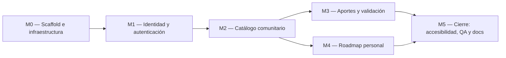

# Implementation Plan — Roadmap de Cursos

> **Qué es:** el orden de construcción. Módulos, dependencias, tareas con su definición de hecho
> y estimaciones. Es lo que ejecuto en la Instancia B, tarea por tarea, rama por rama.
> **Cuándo está bien:** cada tarea tiene un "hecho" verificable sin interpretaciones; el orden
> respeta dependencias reales; el MVP está definido sin ambigüedades — se puede responder
> con un sí o un no a la pregunta "¿el lunes a la noche funciona esto?".
> **Documentos que ordena:** [PRD](PRD.md) (historias `US-xxx`) · [TRD](TRD.md) (decisiones `TD-xxx`, árbol §3.2) ·
> [APPFlow](APPFlow.md) (pantallas) · [BackendSchema](BackendSchema.md) (tablas y endpoints `EP-xx`).

## 1. MVP — qué es P0

> **Criterio de MVP:** en una máquina limpia, `git clone`, `cp .env.example .env` y `docker compose up --build`,
> y recorrer end-to-end las **12 historias P0** del PRD, sin errores en la consola del navegador ni respuestas 5xx en el log del backend.
> **Lo que no es P0** (US-012, US-013, US-014) se construye solo después de verificar el MVP (ver §2.2).

### 1.1 Las 12 historias P0

| Historia | Qué se demuestra en el recorrido |
|----------|----------------------------------|
| US-015 | menú sándwich a 360 px (abre y cierra con X, ESC, clic fuera y clic en un enlace) y navegación horizontal a 768 px |
| US-004 | registrar a *Lucía* (contraseña de 10+ caracteres) y quedar con sesión |
| US-005 | cerrar sesión, volver a entrar, y recibir 429 al 6.º intento fallido |
| US-006 | recuperar la contraseña con el enlace de Mailpit; el enlace sirve una sola vez |
| US-007 | aportar un curso con todos los datos; queda `en_revision` y **no** aparece en el catálogo |
| US-008 | ver el aporte en "Mis aportes" con su estado |
| US-009 | con el validador, aprobar ese aporte (checklist completo) y rechazar otro con motivo; el validador no puede resolver uno propio |
| US-001 | el curso aprobado aparece en `/catalogo` (paginado, 12 por página) y el rechazado no |
| US-002 | buscar por texto (sin tildes ni mayúsculas) y filtrar por categoría |
| US-003 | abrir el detalle, ver aportante y "Lo tomó / No lo tomó", e ir al curso externo |
| US-010 | agregar el curso al roadmap |
| US-011 | cambiar el progreso a "completado" y quitar un curso |

### 1.2 Checklist de aceptación del MVP (sí / no)

- [ ] `docker compose down -v && docker compose up --build` deja los 4 servicios arriba sin intervención manual
- [ ] Los 12 recorridos de §1.1 se completan en orden, sin errores en consola ni 5xx
- [ ] Ningún curso que no esté `publicado` es visible en el catálogo ni por URL directa para un visitante
- [ ] Todos los listados muestran paginador (catálogo, mis aportes, cola de validación, roadmap)
- [ ] `grep -rn "@media" frontend/src | grep -v "min-width" | grep -v "prefers-reduced-motion"` no devuelve nada
- [ ] Lighthouse móvil en `/catalogo`: Accesibilidad ≥ 95 y Performance ≥ 85

## 2. Módulos y dependencias

| Módulo | Depende de | Por qué (dependencia real) | Dominio / feature | Historias |
|--------|------------|----------------------------|-------------------|-----------|
| **M0** Scaffold e infraestructura | — | — | `compartido/`, `app/`, `shared/`, Docker | US-015 |
| **M1** Identidad y autenticación | M0 | necesita servidor, BD, errores, proxy y shell | `identidad/` | US-004, US-005, US-006 |
| **M2** Catálogo comunitario | M1 | la sesión decide qué campos devuelve el catálogo; define la entidad `Curso` y las categorías | `categorias/`, `catalogo/` | US-001, US-002, US-003, (US-014) |
| **M3** Aportes y validación | M1 y M2 | sesión y rol (M1); entidad `Curso`, categorías y catálogo donde aparece lo aprobado (M2) | `aportes/` | US-007, US-008, US-009, (US-012) |
| **M4** Roadmap personal | M1 y M2 | sesión (M1); cursos publicados que agregar (M2; el `seed-demo` los provee aunque M3 no esté) | `roadmap/` | US-010, US-011, (US-013) |
| **M5** Cierre | M3 y M4 | audita el producto completo | transversal | RNF-001, 002, 003, 005, 009 |

> Hay un solo desarrollador, así que M3 y M4 se ejecutan en serie: **M3 antes que M4**, porque contiene el flujo central del producto (aportar → validar → publicar).

### 2.1 Orden de ejecución y hitos

| Hito | Se cumple al cerrar | Qué se puede mostrar |
|------|---------------------|----------------------|
| **H0** | M0 | `docker compose up` levanta los 4 servicios; shell con menú sándwich; `/health` responde |
| **H1** | M1 | registro, login, logout y recuperación de contraseña de punta a punta (con Mailpit) |
| **H2** | M2 | catálogo público navegable con búsqueda, categorías, paginación y detalle (con datos de demostración) |
| **H3** | M3 | el ciclo completo: aportar → en revisión → aprobar/rechazar → aparece en el catálogo |
| **H4** | M4 | roadmap personal con progreso |
| **H5 (MVP)** | M5, tareas 5.1 a 5.5 | el checklist de §1.2 en verde |
| **H6 (release)** | P1 hechas + 5.6 | tag `v0.1.0-mvp` |

### 2.2 Qué es P1 y cuándo se hace

Las seis tareas P1 llevan la marca **(P1)**: 2.4, 2.8, 3.5, 3.9, 4.4 y 4.7. **No** bloquean el MVP.
Se ejecutan **después de la tarea 5.4** (MVP verificado) y antes de 5.6. Cada tarea P1 debe cumplir además la checklist de accesibilidad de UX-UI §6 sobre sus pantallas. Si el tiempo no alcanza, se omiten y la tarea 5.6 deja registro en el README de cuáles quedaron fuera.
**Orden de recorte si hay que elegir:** US-014 (filtros) → US-013 (reordenar) → US-012 (borrador y reenvío).

### 2.3 Estimación total

> Estimaciones en horas de trabajo efectivo de una persona. **Son estimaciones previas, no medidas:** se recalibran con el tiempo real de M0 y M1 (ver riesgo R-01).

| Módulo | Tareas | P0 | P1 | Total |
|--------|--------|----|----|-------|
| M0 | 5 | 8 h | — | 8 h |
| M1 | 7 | 18,5 h | — | 18,5 h |
| M2 | 8 | 18 h | 3,5 h | 21,5 h |
| M3 | 9 | 23,5 h | 6 h | 29,5 h |
| M4 | 7 | 11 h | 4 h | 15 h |
| M5 | 6 | 12,5 h | — | 12,5 h |
| **Total** | **42** | **91,5 h** | **13,5 h** | **105 h** |

## 3. Detalle por módulo

> **Definición de hecho general (aplica a toda tarea, además de su "hecho cuando…"):**
> (1) `docker compose up` sigue levantando sin errores · (2) sin secretos, contraseñas ni tokens en el código ni en el log ·
> (3) respeta las reglas de dependencia entre dominios (TRD §3.1) · (4) el CSS nuevo no usa media queries salvo `min-width: 768px | 1024px` y `prefers-reduced-motion` ·
> (5) la rama se integra por Pull Request con squash merge y commits convencionales · (6) se actualiza la tabla de §4 con la rama y el estado.
> **Convenciones de los comandos de verificación:** `curl` contra `localhost:8000`; las rutas de API llevan el prefijo `/api/v1`;
> los métodos no seguros llevan `-H 'Content-Type: application/json' -H 'Origin: http://localhost:5173'` y las rutas con sesión usan un archivo de cookies (`-c cookies.txt` / `-b cookies.txt`).
> La columna **Refs** liga cada tarea con sus historias (`US`), endpoints (`EP`) y reglas (`BR`).

### M0 — Scaffold e infraestructura

| # | Tarea | Hecho cuando… | Refs | Est. |
|---|-------|----------------|------|------|
| 0.1 | Estructura de carpetas del TRD §3.2, `.env.example`, plantilla de Pull Request y **registro de versiones exactas** | `git ls-files` muestra el árbol del TRD §3.2 (carpetas vacías con `.gitkeep`); `.env.example` lista todas las variables del TRD §4.4 y `git check-ignore .env` imprime `.env`; existe `.github/pull_request_template.md`; las salidas de `pnpm -v`, `uv --version`, `node -v`, `docker --version` y `docker compose version` están escritas con su número exacto en SPEC §6 y TRD §1 (FastAPI 0.158.2, PostgreSQL 18.6, React 19.x) | RNF-007 · TD-012, TD-013 | 1 h |
| 0.2 | `docker-compose.yml` con `postgres:18.6` y `mailpit` | `docker compose up postgres mailpit` deja ambos servicios `healthy`; `docker compose exec postgres psql -U $POSTGRES_USER -d $POSTGRES_DB -c "select version()"` muestra `PostgreSQL 18.6`; `http://localhost:8025` abre la bandeja de Mailpit; tras `docker compose down` y `up` el volumen `pgdata` conserva los datos | RNF-008 | 1 h |
| 0.3 | Backend FastAPI mínimo: `config.py`, `main.py`, `compartido/db.py`, `errores.py` (envelope), `logging.py` (`request_id`), `GET /health` y Dockerfile | `curl -i localhost:8000/health` → 200 `{"status":"ok","db":"ok"}` con header `X-Request-ID`; con `postgres` detenido → 503 `{"status":"degraded","db":"error"}`; `curl -i localhost:8000/api/v1/inexistente` → 404 con `{"error":{"code":"no_encontrado",…,"request_id":…}}`; el log es una línea JSON por request y no contiene cookies ni cuerpos; `/docs` solo responde con `APP_ENV=dev` | EP-23 · TD-003, RNF-012 | 2 h |
| 0.4 | Frontend Vite + React 19: `tokens.css` (UX-UI §2.4), reset, Roboto self-host, router con **todas las rutas del APPFlow §2** (placeholders), `Header` con **menú sándwich** (UX-UI §4.5), toasts, `shared/api/cliente.js` con `ApiError`, pantallas 404 y 403, `lang="es-AR"`, Dockerfile | `docker compose up` muestra el shell en `localhost:5173`; a 360 px la hamburguesa abre y cierra el panel con X, `ESC`, clic en el overlay y clic en un enlace, con `aria-expanded`/`aria-controls` y el foco devuelto al botón; a ≥ 768 px desaparece la hamburguesa y aparece la nav horizontal; `curl -i localhost:5173/api/v1/inexistente` devuelve el 404 con envelope del backend (prueba del proxy de Vite); cada ruta del APPFlow §2 abre su placeholder y una ruta desconocida muestra el 404; `grep -rn "@media" frontend/src \| grep -v "min-width" \| grep -v "prefers-reduced-motion"` no devuelve nada | US-015 · RNF-002, 004, 010, 013 | 3 h |
| 0.5 | Alembic configurado + migración `0001_extension_unaccent` + arranque del backend con `alembic upgrade head` | `docker compose down -v && docker compose up --build` deja los 4 servicios arriba sin pasos manuales; `alembic current` muestra `0001`; `select unaccent('Programación')` devuelve `Programacion` | RNF-008 · TD-007, TD-008 | 1 h |

### M1 — Identidad y autenticación

| # | Tarea | Hecho cuando… | Refs | Est. |
|---|-------|----------------|------|------|
| 1.1 | Modelos `Usuario`, `Sesion`, `TokenRecuperacion`, `EventoRateLimit` + migración `0002_identidad` | `alembic upgrade head` crea las 4 tablas y los tipos `rol_usuario` y `accion_rate_limit` según BackendSchema §1.3; `\d usuarios` muestra `uq_usuarios_email` y `ck_usuarios_email_minuscula`; `alembic downgrade -1` seguido de `upgrade head` termina sin error | BR-007, BR-012 | 1,5 h |
| 1.2 | `seguridad.py` (argon2id con `check_needs_rehash`, tokens de 256 bits y su SHA-256), ciclo de vida de la sesión (crear, validar, renovar 1 vez por hora, borrar), cookie `sid`, dependencia `usuario_actual`, validación de `Origin` y `Content-Type`, y `compartido/rate_limit.py` | `uv run python -c "from app.identidad.seguridad import hash_password, verificar_password as v; h=hash_password('clave-larga-123'); print(h[:9], v(h,'clave-larga-123'), v(h,'otra'))"` imprime `$argon2id True False`; un `POST` a cualquier endpoint con `Origin: http://evil.example` → 403 `origen_no_permitido`; una ruta con sesión requerida sin cookie → 401 `no_autenticado` | RNF-006 · TD-001, TD-005, TD-006 | 3 h |
| 1.3 | `POST /auth/registro`, `POST /auth/login`, `POST /auth/logout`, `GET /auth/me` con rate limiting y limpieza periódica de `eventos_rate_limit` | registro válido → 201 con `usuario` y `Set-Cookie: sid=…; HttpOnly; SameSite=Lax`; en la BD `password_hash` empieza con `$argon2id$` y `sesiones.token_hash` (64 hex) ≠ valor de la cookie; el mismo email con otras mayúsculas → 409 `email_duplicado`; contraseña de 9 caracteres → 422 con `details[0].field = "password"`; el 11.º registro en 1 h desde la misma IP → 429 con `Retry-After`; login correcto → 200 y cookie; email inexistente y contraseña errónea → **el mismo** 401 `credenciales_invalidas`; el 6.º fallo con el mismo email+IP → 429 con `Retry-After` y `meta.retry_after_seconds`; un login correcto borra los fallidos de esa clave; `GET /auth/me` con cookie → 200, sin cookie → 401; `logout` → 204 y luego `/auth/me` → 401 | US-004, US-005 · EP-01, 02, 03, 04 · RF-001..004, 007 · BR-012 | 3,5 h |
| 1.4 | `POST /auth/recuperacion` y `POST /auth/restablecimiento` + `compartido/correo.py` (SMTP a Mailpit, en segundo plano) | `POST /auth/recuperacion` con un email existente y con uno inexistente devuelve 202 con **el mismo cuerpo**; Mailpit recibe **un solo** correo, para el existente, con el enlace `http://localhost:5173/restablecer?token=…`; `POST /auth/restablecimiento` con ese token → 204; reusarlo → 400 `token_invalido`; con `expira_en` llevado al pasado a mano → 400 `token_invalido`; tras restablecer, la cookie de una sesión previa → 401 en `/auth/me`, la contraseña vieja → 401 en login y la nueva → 200; la 4.ª solicitud en 1 h para el mismo email → 429; `tokens_recuperacion.token_hash` no coincide con el token enviado | US-006 · EP-05, 06 · RF-005, 006 · BR-012 | 2,5 h |
| 1.5 | Dependencia `requiere_validador`, CLI `asignar-validador <email>` y seed del validador inicial (`SEED_VALIDADOR_*`) en el arranque, idempotente | `docker compose exec backend uv run python -m app.identidad.cli asignar-validador lucia@example.com` imprime la confirmación y `select rol from usuarios where email='lucia@example.com'` da `validador`; con un email inexistente termina con código ≠ 0 y un mensaje claro; con `SEED_VALIDADOR_*` definidas, `docker compose up` crea al validador y un segundo arranque no duplica ni falla; `GET /auth/me` del validador devuelve `"rol":"validador"` | US-009 · RF-008 · BR-007 | 1,5 h |
| 1.6 | Frontend: sesión (`useSesion` sobre `/auth/me`), guarda de rutas (APPFlow §1), pantallas **Registro** y **Login**, header según rol (APPFlow §2.1) | `/registro` con datos válidos crea la cuenta, muestra el toast y redirige a `/catalogo`; un email duplicado muestra el error junto al campo; entrar a `/aportar` sin sesión redirige a `/login?volver=/aportar` y, al autenticarse, vuelve a `/aportar`; `volver=//evil.com` se ignora; credenciales erróneas muestran "Email o contraseña incorrectos"; el 6.º fallo muestra "Probá de nuevo en N minutos" con el formulario deshabilitado; al cerrar sesión, las rutas protegidas vuelven a `/login`; el header muestra los ítems de la tabla del APPFlow §2.1 según sea visitante, usuario o validador | US-004, US-005 · EP-01..04 · RF-004 | 4 h |
| 1.7 | Frontend: pantallas **Recuperar** y **Restablecer contraseña** | con Mailpit, el flujo completo funciona en el navegador: `/recuperar` muestra el mismo mensaje exista o no el email; el enlace abre `/restablecer?token=…`; la nueva contraseña (≥ 10) con confirmación igual redirige a `/login` con toast y permite entrar; un token usado, vencido o ausente muestra el mensaje y el botón "Pedir un enlace nuevo"; un 429 muestra la alerta con el tiempo restante | US-006 · EP-05, 06 | 2,5 h |

### M2 — Catálogo comunitario

| # | Tarea | Hecho cuando… | Refs | Est. |
|---|-------|----------------|------|------|
| 2.1 | Modelos `Categoria` y `Curso` + migración `0003_categorias_y_cursos` + seed de las 10 categorías (en el arranque) + `app/seed_demo.py` (solo `APP_ENV=dev`, con `--cursos N`) | `\d cursos` muestra `uq_cursos_url_activa`, `ix_cursos_catalogo`, `ix_cursos_cola` y los `CHECK` de BackendSchema §1.4; un `INSERT` de curso `en_revision` sin `url` falla por `ck_cursos_completo_si_no_borrador`; dos cursos activos con la misma `url_normalizada` fallan, pero un `rechazado` con esa URL sí entra; `select count(*) from categorias` = 10 en el orden del PRD Anexo A y no cambia tras reiniciar; tras `docker compose exec backend uv run python -m app.seed_demo` hay ≥ 30 cursos `publicado` de ≥ 5 plataformas y ≥ 6 categorías, y ≥ 3 en `en_revision` | RF-012 · BR-004, BR-009, BR-011 · TD-011 | 3 h |
| 2.2 | `compartido/paginacion.py` (`PageParams`, `Page[T]`) + `GET /categorias` | `GET /api/v1/categorias` → 200 con `total: 10`, `page_size: 50` y las categorías en `orden`; `?page_size=51` → 422 `validacion_fallida`; `?page=0` → 422; `?page=99` → 200 con `items: []` | EP-07 · RNF-001 · BR-015 · TD-002 | 1,5 h |
| 2.3 | `GET /cursos` (paginación, `q`, `categoria`) y `GET /cursos/{id}` | `GET /api/v1/cursos?page=1&page_size=12` → 12 ítems, `total` ≥ 30, ordenados por `publicado_en` desc; ningún curso `en_revision`, `borrador` o `rechazado` aparece; `?q=pyth` y `?q=PYTHÓN` devuelven el mismo resultado; `?q=100%25` no rompe (comodín escapado); `?categoria=1` filtra y se combina con `q`; `GET /cursos/{id}` de un publicado → 200 con `url`; el id de un `en_revision` y un id inexistente → el **mismo** 404 `no_encontrado`; `en_mi_roadmap` y `roadmap_item_id` llegan `false`/`null` (se completan en 4.2) | US-001, 002, 003 · EP-08, 09 · RF-009..011 · BR-001, 015, 016 · TD-007 | 3,5 h |
| 2.4 **(P1)** | Filtros por atributos en `GET /cursos`: `certificado`, `cuestionarios`, `examen`, `aval`, `idioma` | `?certificado=true&examen=false` devuelve solo cursos que cumplen ambos y `total` coincide con la cantidad real; `?idioma=xx` → 422; sin filtros el resultado no cambia | US-014 · EP-08 · RF-013 | 1,5 h |
| 2.5 | Componentes compartidos: `Button`, `Field`, `Chip/Badge`, `CourseCard` (UX-UI §4.3), `Paginador` (§4.4), `Skeleton`, `EmptyState`/`ErrorState` (§4.8), `Alert`, `Modal` (§4.6) | `pnpm build` y `pnpm lint` terminan sin errores; la ruta `/catalogo` renderiza provisoriamente una grilla de 12 `CourseCard` con datos fijos y el paginador cambia de página; `Tab` recorre botón, card y paginador con el foco visible; el paginador es compacto ("Página 2 de 7") a 360 px y numerado con ventana a ≥ 768 px | RNF-005, 009, 013 | 3,5 h |
| 2.6 | Pantalla **Catálogo**: listado paginado, buscador con *debounce* de 300 ms, filtro de categoría, estado en la URL | `/catalogo` muestra un skeleton y luego 12 cards con "Mostrando 1–12 de N"; cambiar de página no recarga ni parpadea; buscar "python" actualiza la lista, vuelve a la página 1 y deja `?q=python` en la URL; categoría y texto se combinan; abrir esa URL en otra pestaña restaura el estado; sin resultados muestra "Limpiar filtros"; con la BD sin cursos muestra "Aportá el primero"; con el backend detenido muestra el error con "Reintentar" que recupera al volver; 1 columna a 360 px, 2 a 768 px y 3 a 1024 px, sin scroll horizontal | US-001, 002 · EP-07, 08 · RNF-001, 009 | 3,5 h |
| 2.7 | Pantallas **Detalle de curso** y **Home** | `/catalogo/:id` muestra categoría, tema, plataforma, versión, año, docentes, idioma, cuestionarios, examen, certificado, aval con su organización, aportante y "Lo tomó / No lo tomó"; "Ir al curso" abre pestaña nueva con `rel="noopener noreferrer"`; el id de un curso no publicado o inexistente muestra la pantalla 404; `/` muestra el hero, los 3 pasos y 6 cards con "Ver todo el catálogo"; con 0 cursos la Home oculta la vista previa y deja el CTA | US-003 · EP-08, 09 · BR-002, 013 | 3 h |
| 2.8 **(P1)** | Frontend: filtros por atributos (panel "Filtros" colapsable en mobile, en línea desde 768 px y lateral desde 1024 px) y chips de filtros activos | activar "Da certificado" y "Requiere examen: no" actualiza lista, total y URL; los chips quitan filtros uno a uno; "Limpiar" restablece; a 360 px el panel se abre con el botón "Filtros" y expone `aria-expanded` | US-014 · EP-08 | 2 h |

### M3 — Aportes y ciclo de validación

| # | Tarea | Hecho cuando… | Refs | Est. |
|---|-------|----------------|------|------|
| 3.1 | Modelo `Validacion` + migración `0004_validaciones` (con trigger de inmutabilidad) + `aportes/url.py` (normalización) | `\d validaciones` muestra `ck_validaciones_aprobado` y `ck_validaciones_rechazado`; un `UPDATE` o `DELETE` sobre `validaciones` falla con el mensaje del trigger; `INSERT` de `aprobado` con una verificación en `false` falla; `rechazado` con motivo de 9 caracteres falla; un script con los 5 ejemplos de BackendSchema §4.2 imprime `OK` en los 5 | BR-004, BR-008, BR-014 | 2 h |
| 3.2 | `POST /aportes` con `enviar=true`: schemas Pydantic (límites de BR-011), service de creación y detección de duplicados | con datos válidos → 201 `{id, estado:"en_revision"}` + `Location`; ese curso **no** aparece en `GET /cursos`; sin sesión → 401; estos casos devuelven 422 `validacion_fallida` y el motivo en `details[].code`: `anio_edicion` 1999 o año en curso + 1 → `fuera_de_rango`; `tiene_aval=true` sin organización → `requerido` en `aval_organizacion`; `confirma_gratuito=false` → `debe_ser_verdadero`; 11 docentes → `demasiados_elementos`; `categoria_id` 999 → `categoria_inexistente`; la misma URL con host en mayúsculas y `?utm_source=x` → 409 `url_duplicada` con `meta.curso_id` y `meta.estado`; dos `POST` simultáneos con la misma URL (`curl … & curl … & wait`) dan un 201 y un 409 | US-007 · EP-10 · RF-014..017 · BR-001..004, 011 | 4 h |
| 3.3 | `GET /aportes` y `GET /aportes/{id}` (mis aportes) | la lista devuelve solo mis aportes, más recientes primero, paginada y con `estado`; `?estado=en_revision` filtra; el detalle de un aporte ajeno → 404 `no_encontrado` (no 403); el detalle incluye `validaciones` (vacío todavía) | US-008 · EP-11, 12 · RF-018 · BR-016 | 1,5 h |
| 3.4 | Validación: `GET /validacion/cola`, `GET /validacion/aportes/{id}`, `POST …/aprobar` y `POST …/rechazar` con `validacion_service.py` | con la cookie del validador la cola lista los `en_revision` del más antiguo al más nuevo con `es_propio`; un usuario común → 403 `sin_permiso` y sin sesión → 401; `aprobar` con las 4 verificaciones → 200 `publicado` y el curso aparece en `GET /cursos`; con una en `false` → 422 `validacion_fallida` con `details[].code = verificaciones_incompletas`; `rechazar` con motivo de 9 caracteres → 422 y con motivo válido → 200 `rechazado`; el autor ve el motivo en `GET /aportes/{id}`; el validador sobre su propio aporte → 403 `aporte_propio`; un segundo `aprobar` sobre el mismo → 409 `estado_invalido`; dos `aprobar` simultáneos dan un 200 y un 409; hay una fila en `validaciones` por decisión | US-009 · EP-15..18 · RF-020..022 · BR-007, 008, 009, 014 | 4 h |
| 3.5 **(P1)** | Borrador (`enviar=false` en EP-10), `PUT /aportes/{id}` y `POST /aportes/{id}/enviar` | un `POST` con solo `titulo` y `enviar=false` → 201 `estado:"borrador"`, que no figura en el catálogo ni en la cola; `PUT` sobre borrador o rechazado → 200 y sobre `en_revision` o `publicado` → 409 `estado_invalido`; `PUT` sobre un rechazado con campos faltantes → 422; `POST …/enviar` sobre un borrador completo → 200 `en_revision` y con campos faltantes → 422 con `details`; sobre un rechazado pasa a `en_revision`, `enviado_en` se actualiza (va al final de la cola) y el historial conserva el motivo anterior; si la URL fue publicada por otra persona → 409 `url_duplicada` | US-012 · EP-10, 13, 14 · RF-019 · BR-009, 010 | 3 h |
| 3.6 | Pantalla **Aportar curso**: formulario en 3 bloques con React Hook Form + Zod (UX-UI §4.2, §5) | los radios sí/no no vienen preseleccionados; "Agregar docente" suma hasta 10 y la organización del aval solo aparece con "sí"; enviar con errores deja el foco en el primer campo inválido con resumen "Revisá N campos" y conserva lo escrito; un envío válido muestra el toast "Tu aporte está en revisión", redirige a `/mis-aportes` y el curso **no** aparece en `/catalogo`; una URL ya publicada muestra la alerta con enlace a `/catalogo/{id}` y una en revisión muestra "Ese enlace ya está en revisión"; los 422 del servidor se mapean a sus campos; con un error de red el formulario no pierde datos; salir con cambios sin guardar pide confirmación | US-007 · EP-07, 10 · RF-014, 015 · BR-002, 003, 011 · TD-009 | 5 h |
| 3.7 | Pantallas **Mis aportes** y **Detalle de mi aporte** | `/mis-aportes` lista paginada con badges de estado y el empty state "Aportar mi primer curso"; el detalle muestra todos los datos, el motivo de rechazo y el historial de decisiones; `/mis-aportes/:id` de otra persona muestra el 404; un aporte publicado ofrece "Ver en el catálogo"; a 360 px las filas son cards y desde 768 px, tabla | US-008 · EP-11, 12 · RF-018 | 3 h |
| 3.8 | Pantallas **Cola de validación** y **Revisión** (checklist y modal de rechazo) | "Validar" aparece en el menú solo para validadores; un usuario común en `/validar` ve la pantalla 403 en la misma URL; la cola es paginada y vacía muestra "¡Buen trabajo!"; en la revisión "Aprobar" queda `aria-disabled` hasta tildar las 4 verificaciones, con texto de ayuda; aprobar muestra "Aporte publicado" y vuelve a la cola; "Rechazar" abre un modal con contador que exige ≥ 10 caracteres; un aporte propio muestra el aviso y deshabilita ambos botones; resolver uno ya resuelto muestra el aviso de conflicto y refresca la cola | US-009 · EP-15..18 · RF-020, 021 · BR-007, 008 | 4 h |
| 3.9 **(P1)** | Frontend: "Guardar borrador", pantalla **Editar aporte** y reenvío tras rechazo | "Guardar borrador" con solo el título crea el borrador y lo muestra en "Mis aportes"; `/mis-aportes/:id/editar` precarga los datos y muestra el último motivo de rechazo; "Enviar a revisión" lo pasa a `en_revision`; un aporte en revisión o publicado redirige al detalle con aviso | US-012 · EP-10, 12, 13, 14 | 3 h |

### M4 — Roadmap personal

| # | Tarea | Hecho cuando… | Refs | Est. |
|---|-------|----------------|------|------|
| 4.1 | Modelo `RoadmapItem` + migración `0005_roadmap` | `\d roadmap_items` muestra `uq_roadmap_usuario_curso` y `uq_roadmap_usuario_orden DEFERRABLE INITIALLY DEFERRED`; dentro de una transacción se pueden intercambiar dos valores de `orden` y el `COMMIT` pasa; repetir (usuario, curso) falla | BR-005, BR-006 · TD-004 | 1 h |
| 4.2 | `POST /roadmap/items` y los campos `en_mi_roadmap` / `roadmap_item_id` en `GET /cursos` y `GET /cursos/{id}` | un curso publicado → 201 con `progreso:"pendiente"` y `orden` consecutivo; repetirlo → 409 `ya_en_roadmap`; un curso `en_revision` o inexistente → 404 `no_encontrado`; sin sesión → 401; con sesión, `GET /cursos` marca `en_mi_roadmap:true` y `roadmap_item_id` solo para **mis** cursos (no los de otro usuario); sin sesión siguen en `false`/`null` | US-010 · EP-20, 08, 09 · RF-023 · BR-005, 006 | 2,5 h |
| 4.3 | `GET /roadmap`, `PATCH /roadmap/items/{id}` (`progreso`) y `DELETE /roadmap/items/{id}` | `GET /roadmap` es paginado, en `orden` ascendente y solo del usuario de la sesión; `PATCH {"progreso":"completado"}` → 200 y un valor inválido → 422; `PATCH` o `DELETE` de un ítem ajeno → 404; `DELETE` → 204, los ítems posteriores bajan una posición (orden contiguo 1..N) y el curso sigue en el catálogo | US-011 · EP-19, 21, 22 · RF-024..026 · BR-005, 006 | 2,5 h |
| 4.4 **(P1)** | `PATCH /roadmap/items/{id}` con `orden` (reordenamiento con bloqueo del usuario) | con 5 ítems, mover el 3.º a la posición 1 deja 1..5 sin huecos y en el orden esperado; `orden: 6` → 422 `validacion_fallida` con `details[].code = fuera_de_rango`; cuerpo `{}` → 422; dos `PATCH` simultáneos no producen duplicados ni 500 | US-013 · EP-21 · RF-027 · BR-006 | 2 h |
| 4.5 | Frontend: botón **Agregar a mi roadmap** en la card y en el detalle | agregar muestra el toast con la acción "Ver mi roadmap" y el botón pasa a "En tu roadmap ✓" (`aria-disabled`); el estado persiste al recargar; sin sesión lleva a `/login?volver=…` y vuelve al curso; un 409 sincroniza el botón; la card agregada muestra el borde `--color-primary` | US-010 · EP-20 · RF-023 | 1,5 h |
| 4.6 | Pantalla **Mi roadmap**: lista paginada, selector de progreso, quitar con modal | cada curso muestra su progreso en un `select` que cambia al instante (optimista), muestra "Progreso actualizado" y se revierte si el servidor falla; "Quitar" pide confirmación y el curso desaparece; si la página queda vacía retrocede una; el roadmap vacío muestra "Explorar el catálogo"; todo persiste al recargar; otro usuario no ve mis cursos | US-011 · EP-19, 21, 22 · RF-024..026 | 3,5 h |
| 4.7 **(P1)** | Frontend: botones **Subir / Bajar** | operables con teclado y deshabilitados en el primero y el último; el orden persiste y es global entre páginas (con 13 o más ítems, "Bajar" el último de la página 1 lo pasa a la página 2) | US-013 · EP-21 · RF-027 | 2 h |

### M5 — Cierre: accesibilidad, QA y documentación

| # | Tarea | Hecho cuando… | Refs | Est. |
|---|-------|----------------|------|------|
| 5.1 | Auditoría de accesibilidad y **reverificación de contrastes** | Lighthouse móvil con Accesibilidad ≥ 95 en `/catalogo`, `/login`, `/aportar` y `/roadmap`; todo el MVP se recorre solo con teclado sin trampas (menú sándwich con `ESC` y foco devuelto, modales con focus trap); foco visible en todo elemento interactivo; con `prefers-reduced-motion` emulado no hay shimmer ni deslizamiento; los pares de color de UX-UI §2.1 se reverificaron en WebAIM y los ratios del documento se corrigieron si diferían | US-015 · RNF-004, 005, 013 | 3 h |
| 5.2 | Auditorías estáticas: **mobile-first** y **Screaming Architecture** | `grep -rn "@media" frontend/src \| grep -v "min-width" \| grep -v "prefers-reduced-motion"` no devuelve nada y todo `min-width` es `768px` o `1024px`; a 360, 768 y 1280 px (y reflow a 320 px) ninguna pantalla del APPFlow §2 tiene scroll horizontal; hamburguesa, paginador y radios miden ≥ 44 px; `grep -rn "from app\.\(identidad\|categorias\|catalogo\|aportes\|roadmap\)\.repository" backend/app` muestra imports solo dentro del propio dominio; no hay carpetas `components/` ni `pages/` globales fuera de `shared/` | RNF-002, 007 · TD-012 | 2 h |
| 5.3 | Estados globales de la UI (APPFlow §5) | cada listado y detalle muestra `loading`, `ok`, `empty` y `error` con "Reintentar" (verificado con el backend detenido y con la BD vacía); aparece el banner "Sin conexión"; una 401 en una request protegida muestra "Tu sesión expiró. Ingresá de nuevo." y redirige a `/login?volver=…`; el *error boundary* captura un error de render forzado; un 500 muestra el `request_id` | RNF-009 · APPFlow §5 | 2,5 h |
| 5.4 | **Recorrido end-to-end del MVP** en una carpeta limpia | `git clone` + `cp .env.example .env` + `docker compose up --build` sin cachés; los 12 recorridos de §1.1 y el checklist de §1.2 se completan en orden, sin errores en la consola del navegador ni 5xx en el log del backend | O7 · RNF-008 · US-001..011, 015 | 2 h |
| 5.5 | Rendimiento del catálogo | con `seed_demo --cursos 1000`, 50 requests a `GET /api/v1/cursos?q=python` dan p95 < 500 ms (`hey` o un script) y `EXPLAIN ANALYZE` queda anotado en la descripción del PR; el LCP del catálogo es < 2,5 s en Lighthouse con 4G simulado | RNF-003 · TD-007 | 1,5 h |
| 5.6 | Cierre documental y release | SPEC §6 y TRD §1 tienen las versiones reales; el README tiene el estado actualizado y la lista de P1 no construidas (si las hay); la tabla §4 de este plan está completa; SPEC §9 registra el cierre; `git tag -n v0.1.0-mvp` muestra un tag anotado sobre `main` y `main` levanta con `docker compose up` | RNF-007, 008 · TD-013 | 1,5 h |

### 3.1 Trazabilidad: historias → tareas

| Historia | Prioridad | Tareas |
|----------|-----------|--------|
| US-001 | P0 | 2.3, 2.5, 2.6 |
| US-002 | P0 | 2.2, 2.3, 2.6 |
| US-003 | P0 | 2.3, 2.7 (botón de roadmap en 4.5) |
| US-004 | P0 | 1.1, 1.2, 1.3, 1.6 |
| US-005 | P0 | 1.2, 1.3, 1.6 |
| US-006 | P0 | 1.4, 1.7 |
| US-007 | P0 | 2.2, 3.1, 3.2, 3.6 |
| US-008 | P0 | 3.3, 3.7 |
| US-009 | P0 | 1.5, 3.1, 3.4, 3.8 |
| US-010 | P0 | 4.1, 4.2, 4.5 |
| US-011 | P0 | 4.3, 4.6 |
| US-012 | P1 | 3.5, 3.9 |
| US-013 | P1 | 4.4, 4.7 |
| US-014 | P1 | 2.4, 2.8 |
| US-015 | P0 | 0.4, 5.1 |

### 3.2 Trazabilidad: endpoints → tareas

| EP | Endpoint | Tarea |
|----|----------|-------|
| EP-01 | `POST /auth/registro` | 1.3 |
| EP-02 | `POST /auth/login` | 1.3 |
| EP-03 | `POST /auth/logout` | 1.3 |
| EP-04 | `GET /auth/me` | 1.3 |
| EP-05 | `POST /auth/recuperacion` | 1.4 |
| EP-06 | `POST /auth/restablecimiento` | 1.4 |
| EP-07 | `GET /categorias` | 2.2 |
| EP-08 | `GET /cursos` | 2.3 (filtros P1: 2.4; `en_mi_roadmap`: 4.2) |
| EP-09 | `GET /cursos/{id}` | 2.3 (`en_mi_roadmap`: 4.2) |
| EP-10 | `POST /aportes` | 3.2 (borrador P1: 3.5) |
| EP-11 | `GET /aportes` | 3.3 |
| EP-12 | `GET /aportes/{id}` | 3.3 |
| EP-13 | `PUT /aportes/{id}` | 3.5 (P1) |
| EP-14 | `POST /aportes/{id}/enviar` | 3.5 (P1) |
| EP-15 | `GET /validacion/cola` | 3.4 |
| EP-16 | `GET /validacion/aportes/{id}` | 3.4 |
| EP-17 | `POST /validacion/aportes/{id}/aprobar` | 3.4 |
| EP-18 | `POST /validacion/aportes/{id}/rechazar` | 3.4 |
| EP-19 | `GET /roadmap` | 4.3 |
| EP-20 | `POST /roadmap/items` | 4.2 |
| EP-21 | `PATCH /roadmap/items/{id}` | 4.3 (progreso) y 4.4 (orden, P1) |
| EP-22 | `DELETE /roadmap/items/{id}` | 4.3 |
| EP-23 | `GET /health` | 0.3 |

### 3.3 Trazabilidad: pantallas del APPFlow → tareas

| Pantalla | Tarea | | Pantalla | Tarea |
|----------|-------|-|----------|-------|
| Shell, 404 y 403 | 0.4 | | Mis aportes y detalle | 3.7 |
| Home | 2.7 | | Editar aporte (P1) | 3.9 |
| Catálogo | 2.6 (filtros P1: 2.8) | | Cola de validación y Revisión | 3.8 |
| Detalle de curso | 2.7 (botón: 4.5) | | Mi roadmap | 4.6 (reordenar P1: 4.7) |
| Registro y Login | 1.6 | | Recuperar y Restablecer | 1.7 |
| Aportar curso | 3.6 | | | |

### 3.4 Trazabilidad: requisitos no funcionales → tareas

| RNF | Tareas donde se construye o verifica |
|-----|--------------------------------------|
| RNF-001 paginación | 2.2, 2.3, 2.5, 2.6, 3.3, 3.4, 4.3 · se audita en 5.4 |
| RNF-002 mobile-first | 0.4 · se audita en 5.2 |
| RNF-003 rendimiento | 5.5 |
| RNF-004 menú sándwich accesible | 0.4, 5.1 |
| RNF-005 accesibilidad AA | 2.5 · se audita en 5.1 |
| RNF-006 seguridad | 1.2, 1.3, 1.4 |
| RNF-007 Screaming Architecture | 0.1 · se audita en 5.2 |
| RNF-008 entorno reproducible | 0.2, 0.5, 5.4 |
| RNF-009 estados de la UI | 2.5, 2.6 · se audita en 5.3 |
| RNF-010 idioma y fechas | 0.4 |
| RNF-011 cobertura ≥ 85 % en services | §5 (se implementa el 27/10) |
| RNF-012 logging sin secretos | 0.3 |
| RNF-013 apariencia Google/Material | 0.4, 2.5 · se audita en 5.1 |

## 4. Ejecución (Instancia B)

> **Regla:** 1 tarea (o lote coherente) = 1 rama `<tipo>/<tarea>-<slug>` desde `main` (TRD §4.1) + commits convencionales con
> `Refs: US-xxx` + Pull Request con squash merge. **Actualizo esta tabla al mergear cada PR:** estado `[x]` y el hash del commit de squash.
> Las ramas ya están nombradas; los commits se completan durante la ejecución.

| # | Tarea | Módulo | Prio | Estado | Rama / Commit |
|---|-------|--------|------|--------|---------------|
| 0.1 | Estructura de carpetas, `.env.example`, PR template y versiones | M0 | P0 | [ ] | `chore/0.1-estructura-carpetas` |
| 0.2 | docker-compose con postgres 18.6 y mailpit | M0 | P0 | [ ] | `docker/0.2-compose-postgres-mailpit` |
| 0.3 | Backend mínimo: errores, logging y `/health` | M0 | P0 | [ ] | `feat/0.3-backend-health` |
| 0.4 | Frontend: shell, rutas, tokens y menú sándwich | M0 | P0 | [ ] | `feat/0.4-frontend-shell` |
| 0.5 | Alembic + migración `unaccent` + arranque integrado | M0 | P0 | [ ] | `chore/0.5-alembic-unaccent` |
| 1.1 | Modelos y migración de identidad | M1 | P0 | [ ] | `feat/1.1-modelos-identidad` |
| 1.2 | Seguridad: argon2id, sesión, cookie, CSRF y rate limit base | M1 | P0 | [ ] | `feat/1.2-seguridad-sesion` |
| 1.3 | Registro, login, logout y `me` | M1 | P0 | [ ] | `feat/1.3-auth-registro-login` |
| 1.4 | Recuperación y restablecimiento de contraseña | M1 | P0 | [ ] | `feat/1.4-recuperacion-password` |
| 1.5 | Rol validador: dependencia, CLI y seed | M1 | P0 | [ ] | `feat/1.5-rol-validador-cli` |
| 1.6 | UI: sesión, guardas, Login y Registro | M1 | P0 | [ ] | `feat/1.6-ui-login-registro` |
| 1.7 | UI: Recuperar y Restablecer | M1 | P0 | [ ] | `feat/1.7-ui-recuperacion` |
| 2.1 | Modelos de curso y categoría, migración y seeds | M2 | P0 | [ ] | `feat/2.1-modelo-cursos-seed` |
| 2.2 | Paginación compartida y `GET /categorias` | M2 | P0 | [ ] | `feat/2.2-api-categorias-paginacion` |
| 2.3 | `GET /cursos` y `GET /cursos/{id}` | M2 | P0 | [ ] | `feat/2.3-api-catalogo` |
| 2.4 | Filtros por atributos (API) | M2 | P1 | [ ] | `feat/2.4-api-filtros-atributos` |
| 2.5 | Componentes compartidos de listado | M2 | P0 | [ ] | `feat/2.5-ui-componentes-listado` |
| 2.6 | UI: Catálogo | M2 | P0 | [ ] | `feat/2.6-ui-catalogo` |
| 2.7 | UI: Detalle de curso y Home | M2 | P0 | [ ] | `feat/2.7-ui-detalle-home` |
| 2.8 | UI: filtros por atributos | M2 | P1 | [ ] | `feat/2.8-ui-filtros-atributos` |
| 3.1 | Modelo de validaciones, migración y normalización de URL | M3 | P0 | [ ] | `feat/3.1-modelo-validaciones-url` |
| 3.2 | `POST /aportes` | M3 | P0 | [ ] | `feat/3.2-api-crear-aporte` |
| 3.3 | Mis aportes (API) | M3 | P0 | [ ] | `feat/3.3-api-mis-aportes` |
| 3.4 | API de validación (cola, aprobar, rechazar) | M3 | P0 | [ ] | `feat/3.4-api-validacion` |
| 3.5 | Borrador, edición y reenvío (API) | M3 | P1 | [ ] | `feat/3.5-api-borrador-reenvio` |
| 3.6 | UI: Aportar curso | M3 | P0 | [ ] | `feat/3.6-ui-aportar` |
| 3.7 | UI: Mis aportes y detalle | M3 | P0 | [ ] | `feat/3.7-ui-mis-aportes` |
| 3.8 | UI: Cola y Revisión | M3 | P0 | [ ] | `feat/3.8-ui-validacion` |
| 3.9 | UI: borrador, editar y reenviar | M3 | P1 | [ ] | `feat/3.9-ui-editar-aporte` |
| 4.1 | Modelo y migración del roadmap | M4 | P0 | [ ] | `feat/4.1-modelo-roadmap` |
| 4.2 | Agregar al roadmap y marca `en_mi_roadmap` | M4 | P0 | [ ] | `feat/4.2-api-agregar-roadmap` |
| 4.3 | Listar, cambiar progreso y quitar (API) | M4 | P0 | [ ] | `feat/4.3-api-roadmap-progreso` |
| 4.4 | Reordenar el roadmap (API) | M4 | P1 | [ ] | `feat/4.4-api-reordenar-roadmap` |
| 4.5 | UI: Agregar a mi roadmap | M4 | P0 | [ ] | `feat/4.5-ui-agregar-roadmap` |
| 4.6 | UI: Mi roadmap | M4 | P0 | [ ] | `feat/4.6-ui-roadmap` |
| 4.7 | UI: Subir y bajar | M4 | P1 | [ ] | `feat/4.7-ui-reordenar-roadmap` |
| 5.1 | Auditoría de accesibilidad y contrastes | M5 | P0 | [ ] | `chore/5.1-accesibilidad` |
| 5.2 | Auditorías estáticas: mobile-first y Screaming | M5 | P0 | [ ] | `chore/5.2-auditorias-estaticas` |
| 5.3 | Estados globales de la UI | M5 | P0 | [ ] | `fix/5.3-estados-globales-ui` |
| 5.4 | Recorrido end-to-end del MVP | M5 | P0 | [ ] | `chore/5.4-recorrido-mvp` |
| 5.5 | Rendimiento del catálogo | M5 | P0 | [ ] | `chore/5.5-rendimiento-catalogo` |
| 5.6 | Cierre documental y tag `v0.1.0-mvp` | M5 | P0 | [ ] | `docs/5.6-cierre-y-release` |

## 5. Estrategia de testing

> Se **planifica** acá y se **implementa** en la clase del 27/10. Hasta entonces, cada tarea se verifica con su "hecho cuando…" (comandos y pasos de UI de §3).
> Los services de M1 a M4 se escriben **sin dependencias de HTTP ni de la BD en sus reglas** (TRD §3.1) para que los tests unitarios del 27/10 no requieran reescribirlos.

**Pirámide y herramientas**

| Nivel | Qué prueba | Herramienta | Entorno |
|-------|-----------|-------------|---------|
| Unit (backend) | reglas de negocio de los `service.py`: transiciones de estado del curso, separación de funciones del validador, normalización de URL, validaciones de BR-011, reglas de rate limiting (ventanas y límites), reordenamiento contiguo del roadmap. Patrón AAA, sin BD ni HTTP | pytest | local |
| Integración (backend) | routers + repositories contra **PostgreSQL real**: códigos de estado y envelope de errores, paginación, visibilidad por estado (BR-016), índice único parcial de URL, resolución concurrente, trigger de `validaciones` | pytest + httpx (`TestClient`) | base `roadmap_test` del Compose, esquema creado con `alembic upgrade head`, cada test dentro de una transacción con *rollback* |
| Frontend | hooks y utilidades: `useSesion`, `usePaginacion`, parseo de `ApiError`, esquemas Zod del aporte, estados `loading`/`error`/`ok` de las queries | Vitest + Testing Library | local |
| Manual / auditoría | accesibilidad, mobile-first, contraste, recorrido E2E | Lighthouse, WebAIM, `grep` (tareas 5.1 a 5.5) | navegador |

> **Por qué PostgreSQL y no SQLite en las pruebas de integración:** el modelo depende de funciones propias de PostgreSQL — `ENUM`, índice único *parcial*, `CHECK` condicionales, restricción `DEFERRABLE`, `unaccent`, triggers y arreglos (`text[]`). Probar contra otro motor daría falsos verdes.

**Casos prioritarios (primeros en escribirse el 27/10)**

| Regla | Caso |
|-------|------|
| BR-001 / BR-016 | un curso `en_revision`, `borrador` o `rechazado` no aparece en `GET /cursos` y su detalle responde 404 a un visitante |
| BR-004 | dos aportes con la misma URL normalizada: el segundo → 409; tras rechazar el primero, el segundo entra |
| BR-007 | un validador no puede aprobar ni rechazar su propio aporte (403 `aporte_propio`) |
| BR-009 | cualquier transición fuera de la tabla del BackendSchema §2 → 409 `estado_invalido` |
| BR-012 | el 6.º login fallido → 429; token de recuperación de un solo uso y con vencimiento; restablecer cierra las sesiones |
| BR-015 | `page_size=51` → 422; una página mayor a la última → 200 con `items: []` |
| BR-005 / BR-006 | el roadmap ajeno es invisible (404); sin duplicados; `orden` contiguo tras agregar, mover y quitar |
| Concurrencia | dos `aprobar` simultáneos → un 200 y un 409; dos envíos simultáneos de la misma URL → un 201 y un 409 |

**Objetivo de cobertura:** **≥ 85 %** de líneas en `service.py` y **≥ 70 %** en el resto del backend (`router.py` y `repository.py`). En el frontend, cobertura de los hooks y esquemas listados (sin objetivo numérico). Los porcentajes se informan en el PR del 27/10; la integración continua (GitHub Actions: lint + tests en cada PR) se configura ese mismo día.

## 6. Riesgos del plan

| # | Riesgo | Impacto | Mitigación |
|---|--------|---------|------------|
| R-01 | El esfuerzo P0 estimado (91,5 h) no cabe en el tiempo disponible, o las estimaciones están subestimadas: no tengo datos de velocidad previos | alto | recalibrar con el tiempo real de M0 y M1 (mismo orden de magnitud que el resto); si hay desvío, recortar en el orden de §2.2 y revisar el alcance P0 con el docente antes de seguir; el camino crítico es US-004 → US-007 → US-009 → US-001 |
| R-02 | El formulario de aporte (15+ campos, lista dinámica, dependencia aval→organización) tarda más de las 5 h de 3.6 | medio | un único esquema Zod por formulario y el mismo contrato de errores por campo del backend (TRD §2.2); empezar por los campos obligatorios y sumar los opcionales al final |
| R-03 | La sesión por cookie y el CSRF por `Origin` fallan en desarrollo por la combinación Vite ↔ Docker ↔ proxy (cookies `Secure`, `Origin` distinto) | medio | tarea 1.2 con prueba explícita de `Origin` ajeno y propio; `COOKIE_SECURE=false` y un solo origen (`localhost:5173`) vía el proxy de Vite; probar el login desde el navegador en cuanto exista 1.6 |
| R-04 | Las condiciones de carrera (doble aprobación, URL duplicada simultánea, reordenamiento) pasan inadvertidas porque no hay tests hasta el 27/10 | medio | los criterios de 3.2, 3.4 y 4.4 incluyen pruebas con requests simultáneos; la BD es la red de seguridad (índice único parcial, `UPDATE … WHERE estado = …`, bloqueo del usuario) |
| R-05 | El mail de recuperación no llega o el enlace se rompe (SMTP, `FRONTEND_BASE_URL`) | alto | Mailpit en el Compose desde 0.2; el criterio de 1.4 incluye abrir el enlace real de Mailpit y 1.7 repite el flujo en el navegador |
| R-06 | Deriva entre documentos al cambiar algo durante la Instancia B (APPFlow, BackendSchema y Plan quedan desalineados) | alto | el cambio de un endpoint o de una pantalla se hace primero en el documento y recién después en el código, en el mismo PR; las tablas de §3.1 a §3.4 de este plan sirven como lista de revisión; la tarea 5.6 repite la revisión cruzada antes del tag |
| R-07 | La búsqueda con `unaccent` + `ILIKE` se degrada con más cursos de los previstos (hoy un *scan* secuencial) | bajo | la tarea 5.5 mide con 1.000 cursos; si no cumple, función envoltorio inmutable e índice `pg_trgm` (TRD TD-007) |
| R-08 | Dependencias nativas (`argon2-cffi`, `psycopg`) o permisos de volumen de PostgreSQL 18 fallan en Docker de algunas máquinas | medio | usar `psycopg[binary]` y *wheels* de `argon2-cffi`; en 0.2 verificar el volumen en `/var/lib/postgresql` (cambio de PostgreSQL 18) y que `down -v` + `up` funcione desde cero |
| R-09 | Roboto, Material Symbols y la reverificación de contrastes consumen más tiempo del previsto | bajo | solo los ~25 iconos usados como SVG inline y Roboto self-host de 3 pesos (UX-UI §7); la reverificación se hace una sola vez en 5.1 |
| R-10 | Hay un único revisor de los PR (el propio desarrollador) y se cuelan errores | medio | checklist obligatoria en la plantilla de PR (criterio "hecho", sin secretos, `docker compose up` verificado, docs al día) y revisión docente sobre el PR y el tag de entrega |

---

**Referencias:**
- Atlassian — Plantilla de plan de proyecto: https://www.atlassian.com/software/confluence/templates/project-plan
- Shape Up — cómo partir trabajo real en scopes cerrables: https://basecamp.com/shapeup/
- Conventional Commits 1.0.0: https://www.conventionalcommits.org/
