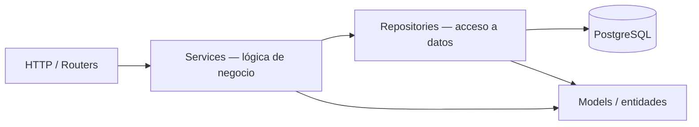
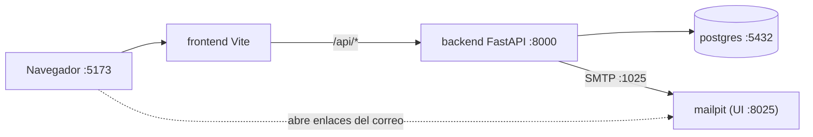

# TRD — Technical Requirements Document — Roadmap de Cursos

> **Qué es:** el CÓMO técnico. Decisiones de arquitectura, stack, estructura de carpetas y
> convenciones. No es el plan de tareas (eso es el [IMPLEMENTATION_PLAN](IMPLEMENTATION_PLAN.md)) ni el producto ([PRD](PRD.md)).
> **Cuándo está bien:** un developer que no estuvo en la charla puede levantar el proyecto y
> tomar las mismas decisiones que yo; cada decisión importante tiene alternativas, la opción
> elegida y el porqué.
> **Origen de las decisiones:** [SPEC §8](SPEC.md#8-vacíos-de-la-spec-de-clase-y-decisiones-tomadas).

## 1. Stack y versiones exactas

> Las versiones fijadas por la SPEC (FastAPI 0.158.2, PostgreSQL 18.6, React 19.x) están acá y en
> [SPEC §6](SPEC.md#6-stack-registrado-versiones-exactas-con-las-que-se-va-a-desarrollar).
> Las marcadas "lockfile" se escriben con número exacto en la tarea 0.1 del plan (Instancia B) a
> partir de lo que realmente quede instalado (`pnpm-lock.yaml`, `uv.lock`), y se vuelcan a la SPEC §6.

| Capa | Elección | Versión exacta | Por qué |
|------|----------|----------------|---------|
| Frontend | React + Vite + pnpm | React **19.x** · Vite y pnpm: lockfile | fijado por SPEC |
| Frontend — rutas | React Router (router de datos, `createBrowserRouter`) | lockfile | rutas anidadas, guardas de acceso, `loader`-free (los datos van por TanStack Query) |
| Frontend — estado de servidor | TanStack Query | lockfile | caché, reintentos y paginación con `placeholderData: keepPreviousData` (sin parpadeo al cambiar de página) |
| Frontend — formularios | React Hook Form + Zod | lockfile | un único esquema de validación por formulario, compartido por todos los campos del aporte (12+ campos) |
| Frontend — estilos | CSS Modules + tokens CSS (custom properties) | — | control total del mobile-first y auditoría simple de media queries (ver TD-010) |
| Frontend — tests | Vitest + Testing Library | lockfile | integrado con Vite |
| Backend | FastAPI + uv | FastAPI **0.158.2** · Python **3.13** · uv: lockfile | fijado por SPEC |
| Backend — validación | Pydantic v2 (viene con FastAPI) | lockfile | schemas de request/response tipados |
| ORM / driver | SQLAlchemy 2.0 (síncrono, estilo declarativo tipado) + psycopg 3 + Alembic | lockfile | ver TD-008 |
| Hash de contraseñas | argon2-cffi (argon2id) | lockfile | ver TD-005 |
| Correo (dev) | `smtplib` de la stdlib + `BackgroundTasks` → Mailpit | — | un único correo transaccional (recuperación) |
| Backend — tests y calidad | pytest + httpx · Ruff (lint y formato) | lockfile | |
| BD | PostgreSQL | **18.6** + extensión `unaccent` | fijado por SPEC |
| Infra (dev) | Docker + Compose · Node 24 LTS (imagen del frontend) · Mailpit | lockfile / tag fijado en compose | SPEC §6 |

## 2. Decisiones técnicas

| # | Decisión | Alternativas consideradas | Elegida | Por qué |
|---|----------|---------------------------|---------|---------|
| TD-001 | Autenticación y sesión | JWT stateless · sesión server-side con cookie · OAuth externo | **Sesión server-side con cookie opaca** | Permite logout e invalidación real (US-005) y cerrar todas las sesiones al restablecer la contraseña (US-006); la cookie `HttpOnly` mantiene el identificador fuera del alcance de JavaScript (XSS). OAuth está fuera de alcance. Costo: una consulta por request (índice por hash), aceptable para el volumen. Detalle en §2.4. |
| TD-002 | Estrategia de paginación | offset + total · cursor (keyset) | **offset + total** | Paginador numerado en la UI (UX-UI §4.4) y volumen de miles de filas. Fundamentación completa en §2.1. |
| TD-003 | Formato de errores de API | envelope propio · RFC 7807/9457 (`problem+json`) | **Envelope propio `{ "error": {…} }`** | Un único cliente (la SPA), necesidad de errores por campo y códigos estables para mapear a mensajes. Detalle y catálogo en §2.2. |
| TD-004 | Cómo modelar "mi roadmap" | tabla intermedia con estado · referencia directa en el usuario · copia del curso | **Tabla intermedia `roadmap_items`** (`usuario_id`, `curso_id`, `progreso`, `orden`) con `UNIQUE(usuario_id, curso_id)` | Un curso no se duplica (BR-006), el progreso y el orden son atributos de la relación, y el roadmap es privado por construcción (toda consulta filtra por `usuario_id` de la sesión). El `orden` es único por usuario con restricción `DEFERRABLE INITIALLY DEFERRED` para poder reordenar dentro de una transacción. |
| TD-005 | Hash de contraseñas | bcrypt (mínimo de la SPEC) · argon2id · scrypt | **argon2id** con `argon2-cffi` | Supera el mínimo exigido: es resistente a GPU/ASIC por su costo de memoria y es la primera recomendación de OWASP. Parámetros: perfil de baja memoria de RFC 9106 (t=3, m=64 MiB, p=4, los valores por defecto de la librería), con `check_needs_rehash` para migrar parámetros en el login. Contraseña de 10 a 128 caracteres (el tope evita DoS por entradas enormes). Para emails inexistentes se verifica contra un hash señuelo para igualar tiempos de respuesta. |
| TD-006 | Dónde viven los contadores de rate limiting | en memoria del proceso · Redis · tabla en PostgreSQL | **Tabla `eventos_rate_limit` en PostgreSQL** | El stack fijado por la SPEC no incluye Redis; en memoria se pierde al reiniciar y no es consistente entre workers. Cada intento relevante inserta una fila (`accion`, `clave`, `creado_en`) y se cuenta por ventana; una limpieza periódica borra lo vencido. Ver §2.5. |
| TD-007 | Búsqueda de texto | `ILIKE` + `unaccent` · Full-Text Search (`tsvector`) · `pg_trgm` · motor externo | **`unaccent(col) ILIKE unaccent('%q%')`** sobre título, tema y docentes | Cumple "coincidencia parcial sin tildes ni mayúsculas" (US-002), sin infraestructura extra; con ≤ 5.000 cursos un scan secuencial responde muy por debajo de 500 ms (RNF-003). Los comodines `%`, `_` y `\` del input se escapan. Si el volumen crece, se agrega un índice `pg_trgm` sobre una función inmutable. |
| TD-008 | ORM, migraciones y transacciones | SQLModel · SQLAlchemy 2.0 · SQL con psycopg a mano · modo async | **SQLAlchemy 2.0 síncrono + Alembic** | Separa ORM (`models.py`) de schemas de API (`schemas.py`), cosa que SQLModel mezcla. El modo síncrono corre en el threadpool de FastAPI y evita la complejidad de async para este volumen. Los repositories **nunca** hacen commit; cada service decide la frontera transaccional (un caso de uso = una transacción). Esquema solo por migraciones Alembic. |
| TD-009 | Estado de servidor y formularios en el frontend | `useEffect` + `fetch` manual · TanStack Query · Redux | **TanStack Query + React Hook Form/Zod** | Caché, estados `loading/error/ok` y reintentos de serie (RNF-009), y paginación sin parpadeo. No hay estado global de cliente que justifique Redux: la sesión vive en una query (`/auth/me`). |
| TD-010 | Estilos | CSS Modules + tokens · Tailwind · MUI (Material UI) | **CSS Modules + custom properties** | La SPEC pide mobile-first *auditable*: con CSS propio se verifica con un `grep` que la base no tiene media queries (§5). MUI traería Material "de fábrica" pero con peso, theming a medida y estilos que habría que pelear para respetar los tokens exactos de la UX-UI. Tailwind es mobile-first, pero la guía visual está definida como variables CSS, no como utilidades. |
| TD-011 | Identificadores | enteros `IDENTITY` · UUID | **Enteros `GENERATED ALWAYS AS IDENTITY`** | URLs legibles (`/catalogo/42`) y joins livianos. Que sean enumerables no filtra datos: la visibilidad se decide por estado y rol (BR-016), no por opacidad del ID. |
| TD-012 | Organización del código | capas técnicas (`routers/`, `services/`, `models/`) · feature-first con capas dentro (Screaming) | **Screaming Architecture + capas por dominio** | Exigido por la SPEC; justificación en §3.1. |
| TD-013 | Flujo de versionado | GitHub Flow · trunk-based · GitFlow | **GitHub Flow + Conventional Commits** | Un solo desarrollador, `main` siempre desplegable y ramas cortas por tarea del plan. Detalle en §4. |

### 2.1 Paginación: offset + total vs. cursor

| Criterio | offset + total | cursor (keyset) |
|----------|----------------|-----------------|
| Paginador numerado "‹ 1 2 3 … ›" (UX-UI §4.4) | ✅ nativo | ❌ solo "siguiente/anterior" |
| Saltar a una página arbitraria | ✅ | ❌ |
| Total de resultados ("47 cursos") | ✅ con un `COUNT` | ➖ requiere consulta aparte |
| Estabilidad si cambian los datos durante la navegación | ➖ puede repetir o saltear un ítem | ✅ |
| Costo en páginas profundas | ➖ crece con `OFFSET` | ✅ constante |
| Complejidad de implementación | ✅ baja | ➖ media (cursor opaco, orden compuesto) |

**Decisión:** offset + total. El costo de `OFFSET` es irrelevante con el volumen previsto
(≤ 5.000 cursos, ≤ 500 usuarios; SPEC/PRD §9), mientras que el paginador numerado y el total son
requisitos de experiencia. La inestabilidad ante escrituras concurrentes es tolerable (un curso
nuevo puede correr el listado un lugar).

**Contrato** (se repite en [BackendSchema](BackendSchema.md) §3):

- Query: `page` (entero ≥ 1, defecto 1) y `page_size` (entero 1–50, defecto 12). Fuera de rango → `422 validacion_fallida`.
- Respuesta: `{ "items": [...], "total": N, "page": n, "page_size": n }`. Una página mayor a la última devuelve `200` con `items: []` (no 404).
- Orden **determinístico**: siempre con desempate por `id` (`ORDER BY publicado_en DESC, id DESC` en el catálogo; la cola de validación va en `enviado_en ASC, id ASC`).
- Se implementa una sola vez en `compartido/paginacion.py` y lo usan los cuatro listados (catálogo, roadmap, mis aportes, cola de validación).
- **Criterio de revisión:** si el catálogo supera ~50.000 filas o se pasa a scroll infinito, se migra a keyset (el cambio queda contenido en `catalogo/repository.py`).

### 2.2 Envelope de errores

**Estructura** (toda respuesta 4xx/5xx de la API, sin excepción):

```json
{
  "error": {
    "code": "validacion_fallida",
    "message": "Hay campos con errores.",
    "details": [
      { "field": "anio_edicion", "code": "fuera_de_rango", "message": "El año debe estar entre 2000 y 2026." }
    ],
    "meta": {},
    "request_id": "01JBX7Q2M5N9V3K8T4R6W1Z0YH"
  }
}
```

| Campo | Tipo | Regla |
|-------|------|-------|
| `code` | string estable (snake_case) | Identifica el error para el cliente; **no cambia** aunque cambie el texto. |
| `message` | string en español | Legible para una persona; el frontend puede reemplazarlo por su propio texto según `code`. |
| `details` | array opcional | Errores por campo (`field`, `code`, `message`); solo en `422`. |
| `meta` | objeto opcional | Datos de contexto del error (ej. `curso_id` y `estado` del duplicado; `retry_after_seconds` en 429). |
| `request_id` | string | Mismo valor que el header `X-Request-ID`; permite rastrear el error en los logs. |

**Ejemplos:**

```json
// 409 — URL duplicada
{ "error": { "code": "url_duplicada", "message": "Ese enlace ya está en el catálogo.",
             "meta": { "curso_id": 42, "estado": "publicado" }, "request_id": "…" } }

// 429 — rate limiting (con header Retry-After: 540)
{ "error": { "code": "demasiados_intentos", "message": "Demasiados intentos. Probá de nuevo en 9 minutos.",
             "meta": { "retry_after_seconds": 540 }, "request_id": "…" } }
```

**Catálogo de códigos** (el BackendSchema los reutiliza en cada endpoint):

| HTTP | `code` | Cuándo |
|------|--------|--------|
| 400 | `token_invalido` | Token de recuperación inexistente, vencido o ya usado (un único código: no se distingue) |
| 401 | `no_autenticado` | No hay sesión válida o expiró |
| 401 | `credenciales_invalidas` | Email o contraseña incorrectos (sin revelar cuál) |
| 403 | `sin_permiso` | El rol no alcanza (ej. no es validador) o el recurso es de otro usuario |
| 403 | `aporte_propio` | Un validador intenta resolver su propio aporte (BR-007) |
| 403 | `origen_no_permitido` | Método no seguro con `Origin` fuera de la lista permitida (§2.4) |
| 404 | `no_encontrado` | El recurso no existe **o** no es visible para quien consulta (BR-016) |
| 409 | `email_duplicado` | Registro con un email ya existente |
| 409 | `url_duplicada` | La URL normalizada ya está en un curso activo (BR-004) |
| 409 | `ya_en_roadmap` | El curso ya está en el roadmap del usuario (BR-006) |
| 409 | `estado_invalido` | La acción no es válida en el estado actual (editar un publicado, resolver un aporte ya resuelto, etc.) |
| 422 | `validacion_fallida` | Entrada inválida (incluye `details` por campo) |
| 429 | `demasiados_intentos` | Rate limiting (con `Retry-After`) |
| 500 | `error_interno` | Error no controlado; **nunca** expone el detalle (se registra con el `request_id`) |

**Por qué un envelope propio y no RFC 7807/9457:** el único consumidor es nuestra SPA, por lo que no
hay beneficio de interoperabilidad que justifique `application/problem+json`; en cambio, el envelope
nos da un formato único para errores generales y por campo, con `code` estable para mapear
mensajes y comportamiento. Si aparecieran clientes externos, la migración es mecánica (`code` → `type`,
`message` → `title`/`detail`).

### 2.3 Cómo se traduce cada excepción

- Los **services** lanzan excepciones de dominio (`ErrorDeDominio` con `code`, `status`, `message`, `meta`); nunca `HTTPException`.
- Un único manejador en `main.py` las convierte al envelope. También convierte `RequestValidationError` de FastAPI (→ 422 con `details`), los `HTTPException` residuales (404/405) y cualquier excepción no controlada (→ 500 `error_interno`, con stack trace solo en el log).
- El **frontend** centraliza el parseo en `shared/api/cliente.js`: lanza un `ApiError { status, code, message, details, meta }`; las pantallas deciden la UX según `code`.

### 2.4 Sesión, CSRF y cookies (detalle de TD-001)

- **Identificador:** 256 bits aleatorios (`secrets.token_urlsafe(32)`). En la BD solo se guarda su SHA-256 (`sesiones.token_hash`): una filtración de la tabla no permite usar sesiones.
- **Cookie `sid`:** `HttpOnly`, `SameSite=Lax`, `Path=/`, `Secure` salvo en desarrollo (`COOKIE_SECURE`). El navegador habla siempre con el mismo origen (en dev, el proxy de Vite envía `/api/*` al backend), así que no hace falta CORS con credenciales.
- **Vencimiento:** 7 días de inactividad (deslizante; `ultimo_uso` se renueva como máximo una vez por hora para no escribir en cada request) y 30 días absolutos. Logout y restablecimiento de contraseña borran las sesiones.
- **CSRF:** `SameSite=Lax` + en todo método no seguro (`POST/PUT/PATCH/DELETE`) se exige `Content-Type: application/json` (fuerza preflight CORS) y se valida que el header `Origin` esté en `ALLOWED_ORIGINS`; si no → `403 origen_no_permitido`.
- **Recuperación de contraseña:** token de 256 bits, guardado hasheado (`tokens_recuperacion`), vigencia 30 min, un solo uso, y respuesta idéntica exista o no el email. El enlace es `FRONTEND_BASE_URL/restablecer?token=…`.

### 2.5 Rate limiting (detalle de TD-006)

| Acción | Clave | Límite | Ventana | Qué cuenta |
|--------|-------|--------|---------|------------|
| Login | `email_normalizado + IP` | 5 | 15 min | intentos **fallidos** |
| Login | `IP` | 20 | 15 min | intentos **fallidos** |
| Recuperación | `email_normalizado` | 3 | 1 h | solicitudes |
| Recuperación | `IP` | 10 | 1 h | solicitudes |
| Registro | `IP` | 10 | 1 h | registros |

- Se consulta **antes** de verificar credenciales; si se superó el límite → `429 demasiados_intentos` con `Retry-After`.
- Un login exitoso limpia los fallidos de esa clave (email+IP).
- La IP se toma de `request.client`; solo se confía en `X-Forwarded-For` si `TRUST_PROXY_HEADERS=true` (y el proxy es nuestro). Nunca se acepta ese header "a ciegas" (sería trivial eludir el límite).

## 3. Arquitectura

### 3.1 Patrón y capas

**Screaming Architecture + arquitectura en capas.** La carpeta de primer nivel dice *qué hace el negocio* (identidad, catálogo, aportes, roadmap) y, dentro de cada dominio, las capas técnicas separan responsabilidades:



- **Routers (controllers):** reciben HTTP, validan input con schemas, resuelven sesión/rol por dependencias y delegan. Sin lógica de negocio.
- **Services:** reglas de negocio (BR-xxx) puras y testeables; deciden la transacción; lanzan excepciones de dominio. Sin SQL y sin objetos HTTP.
- **Repositories:** única puerta a la BD (consultas SQLAlchemy). Sin reglas de negocio y sin `commit`.
- **Models / Schemas:** `models.py` (entidades ORM) y `schemas.py` (Pydantic de entrada y salida).
- **La estructura de carpetas habla del dominio**, no del framework.

**Por qué Screaming Architecture (justificación técnica):**

1. **El dominio es visible.** Abrir `backend/app/` muestra `identidad/ catalogo/ aportes/ roadmap/`: se entiende para qué es el sistema antes de leer código. Una estructura por capas técnicas (`routers/ services/ models/`) solo diría "es una app FastAPI".
2. **Cohesión alta, acoplamiento bajo.** Una historia de usuario toca casi siempre un solo dominio, así que un cambio vive en una carpeta y en una rama (GitHub Flow, §4). En capas técnicas, cada cambio atravesaría tres o cuatro carpetas.
3. **Trazabilidad 1:1 con los documentos.** Dominio ↔ módulo del plan ↔ historias del PRD (tabla abajo): un revisor puede seguir una regla de negocio desde el PRD hasta el archivo que la implementa.
4. **Límites explícitos y verificables.** Las reglas de dependencia entre dominios (más abajo) se pueden revisar con un `grep` de imports, y mantienen la puerta abierta a extraer un dominio si algún día hiciera falta.
5. **Espejo en el frontend.** `features/<dominio>` evita carpetas globales `components/` y `pages/` que acumulan todo.

**Costos asumidos:** hay algunos archivos repetidos por dominio (`router`, `service`, `repository`) y un núcleo compartido (`compartido/`) que hay que vigilar para que no se convierta en un cajón de sastre: solo entra ahí lo que usan **tres o más** dominios y no tiene reglas de negocio.

| Dominio (backend) | Feature (frontend) | Módulo del plan | Historias |
|-------------------|--------------------|-----------------|-----------|
| `identidad/` | `features/identidad` | M1 | US-004, US-005, US-006 |
| `categorias/` | (se consume desde catálogo y aportes) | M2 | US-002, US-007 |
| `catalogo/` | `features/catalogo` | M2 | US-001, US-002, US-003, US-014 |
| `aportes/` (incluye validación) | `features/aportes` y `features/validacion` | M3 | US-007, US-008, US-009, US-012 |
| `roadmap/` | `features/roadmap` | M4 | US-010, US-011, US-013 |
| `compartido/` · `app/` + `shared/` | shell, layout, menú sándwich | M0 | US-015 |

**Reglas de dependencia entre dominios:**

| Desde → Hacia | Permitido | Prohibido |
|---------------|-----------|-----------|
| cualquier dominio → `identidad` | dependencias de FastAPI (`usuario_actual`, `requiere_validador`) | importar su repository |
| `catalogo`, `aportes` → `categorias` | su **service** | su repository |
| `aportes`, `roadmap` → `catalogo` | su **service** y la entidad `Curso` (`catalogo/models.py`) | su repository |
| cualquier dominio → `compartido` | siempre | — |
| `compartido` → dominios | — | siempre (el núcleo no conoce el negocio) |

> La entidad `Curso` vive en `catalogo/models.py`; `aportes` la importa para gestionar su ciclo de vida
> y `roadmap` para validar que esté publicada. Esto evita duplicar el modelo sin acoplar repositories.

### 3.2 Estructura de carpetas (la que se va a crear en la Instancia B)

```
roadmap-de-cursos/
├── backend/
│   ├── pyproject.toml
│   ├── uv.lock
│   ├── .python-version
│   ├── Dockerfile
│   ├── alembic.ini
│   ├── migrations/                      # Alembic (versions/…)
│   ├── app/
│   │   ├── main.py                      # crea la app, middleware, manejadores de error, routers
│   │   ├── config.py                    # settings desde variables de entorno
│   │   ├── seed_demo.py                 # datos de demostración (solo dev, ejecución manual)
│   │   ├── compartido/                  # núcleo sin reglas de negocio
│   │   │   ├── db.py                    # engine, SessionLocal, dependencia get_db
│   │   │   ├── errores.py               # ErrorDeDominio y subclases, envelope
│   │   │   ├── paginacion.py            # PageParams, Page[T], helper de consulta
│   │   │   ├── rate_limit.py            # eventos_rate_limit: registrar y contar
│   │   │   ├── correo.py                # envío SMTP (smtplib)
│   │   │   └── logging.py               # JSON logging + middleware de request_id
│   │   ├── identidad/                   # registro, login, sesión, recuperación, roles
│   │   │   ├── router.py                # /auth/*
│   │   │   ├── service.py
│   │   │   ├── repository.py
│   │   │   ├── models.py                # Usuario, Sesion, TokenRecuperacion
│   │   │   ├── schemas.py
│   │   │   ├── seguridad.py             # argon2id, tokens, cookies
│   │   │   └── cli.py                   # asignar-validador <email>, seed inicial
│   │   ├── categorias/
│   │   │   ├── router.py                # GET /categorias
│   │   │   ├── service.py
│   │   │   ├── repository.py
│   │   │   ├── models.py
│   │   │   ├── schemas.py
│   │   │   └── seed.py                  # 10 categorías (PRD Anexo A), idempotente
│   │   ├── catalogo/                    # lectura pública de cursos publicados
│   │   │   ├── router.py                # GET /cursos, /cursos/{id}
│   │   │   ├── service.py
│   │   │   ├── repository.py            # búsqueda, filtros, paginación
│   │   │   ├── models.py                # Curso (entidad compartida)
│   │   │   └── schemas.py
│   │   ├── aportes/                     # ciclo de vida del curso + validación
│   │   │   ├── router.py                # /aportes/*
│   │   │   ├── validacion_router.py     # /validacion/*
│   │   │   ├── service.py               # crear, editar, enviar, reglas BR-004/009/010
│   │   │   ├── validacion_service.py    # aprobar/rechazar, BR-007/008/014
│   │   │   ├── repository.py
│   │   │   ├── models.py                # Validacion (auditoría)
│   │   │   ├── schemas.py
│   │   │   └── url.py                   # normalización de URL (BR-004)
│   │   └── roadmap/
│   │       ├── router.py                # /roadmap/*
│   │       ├── service.py
│   │       ├── repository.py
│   │       ├── models.py                # RoadmapItem
│   │       └── schemas.py
│   └── tests/
│       ├── unit/                        # services (sin BD ni HTTP)
│       ├── integration/                 # routers + repositories contra PostgreSQL
│       └── conftest.py
├── frontend/
│   ├── package.json
│   ├── pnpm-lock.yaml
│   ├── Dockerfile
│   ├── vite.config.js                   # proxy /api → backend
│   └── src/
│       ├── main.jsx
│       ├── app/                         # shell: router, layout, Header + menú sándwich, guardas
│       ├── features/
│       │   ├── identidad/               # login, registro, recuperar, restablecer, sesión
│       │   ├── catalogo/                # home (vista previa), listado, detalle, filtros
│       │   ├── aportes/                 # aportar, mis aportes, detalle, editar
│       │   ├── validacion/              # cola y revisión (rol validador)
│       │   └── roadmap/
│       │       ├── components/
│       │       ├── hooks/
│       │       ├── api.js
│       │       └── RoadmapPage.jsx      # (cada feature repite esta forma)
│       ├── shared/                      # lo usado por 3+ features
│       │   ├── api/cliente.js           # fetch + ApiError (§2.3)
│       │   ├── components/              # Button, Field, Card, Badge, Paginador, Modal, Toast…
│       │   ├── icons/                   # SVG de Material Symbols usados
│       │   └── hooks/
│       └── styles/                      # tokens.css (UX-UI §2.4), reset.css, global.css
├── docker-compose.yml
├── .env.example
├── .gitignore
├── .github/
│   └── pull_request_template.md
└── docs/                                # SPEC, PRD, TRD, UX-UI, APPFlow, BackendSchema, IMPLEMENTATION_PLAN
```

### 3.3 Servicios Docker (entorno de desarrollo)

| Servicio | Imagen/base | Puerto | Rol |
|----------|-------------|--------|-----|
| postgres | `postgres:18.6` | 5432 | base de datos (volumen nombrado `pgdata`) |
| backend | `python:3.13-slim` + uv | 8000 | API FastAPI con `uvicorn --reload`; al arrancar ejecuta `alembic upgrade head` y el seed idempotente de categorías y del validador inicial |
| frontend | `node:24-alpine` + pnpm (corepack) | 5173 | SPA con el dev server de Vite (HMR) y proxy `/api` → backend |
| mailpit | `axllent/mailpit:<tag fijado>` | 8025 (UI) · 1025 (SMTP) | bandeja de correos de desarrollo (enlaces de recuperación) |



Esqueleto orientativo de `docker-compose.yml` (se materializa en la tarea 0.2 del plan):

```yaml
services:
  postgres:
    image: postgres:18.6
    environment:
      POSTGRES_USER: ${POSTGRES_USER}
      POSTGRES_PASSWORD: ${POSTGRES_PASSWORD}
      POSTGRES_DB: ${POSTGRES_DB}
    volumes:
      - pgdata:/var/lib/postgresql        # PostgreSQL 18: la imagen espera el volumen en este directorio
    healthcheck:
      test: ["CMD-SHELL", "pg_isready -U $${POSTGRES_USER} -d $${POSTGRES_DB}"]
      interval: 5s
      retries: 10
    ports: ["5432:5432"]
  mailpit:
    image: axllent/mailpit:<tag>
    ports: ["8025:8025", "1025:1025"]
  backend:
    build: ./backend
    env_file: .env
    depends_on:
      postgres: { condition: service_healthy }
    volumes: ["./backend:/app"]
    ports: ["8000:8000"]
  frontend:
    build: ./frontend
    env_file: .env
    depends_on: [backend]
    volumes: ["./frontend:/app", "/app/node_modules"]
    ports: ["5173:5173"]
volumes:
  pgdata:
```

> En la clase del 27/10 estos Dockerfiles evolucionan a multi-stage. Por ahora, lo mínimo que levanta.

## 4. Convenciones

### 4.1 Flujo de Git: GitHub Flow

- **Rama permanente:** solo `main`, protegida (sin push directo, PR obligatorio, historial lineal). **`main` siempre levanta con `docker compose up`.**
- **Ramas de trabajo:** cortas, creadas desde `main`, una por tarea (o lote coherente) del Implementation Plan.
  Formato: `<tipo>/<tarea>-<slug>`, con `<tipo>` ∈ `feat | fix | docs | test | refactor | chore | docker` y `<tarea>` el número del plan.
  Ejemplos: `feat/1.2-login-rate-limit`, `feat/2.3-pantalla-catalogo`, `docker/0.2-compose-postgres`, `docs/prd-reglas-de-negocio`.
- **Pull Request:** título en formato Conventional Commit; descripción con la plantilla `.github/pull_request_template.md`
  (tarea del plan y historia US-xxx, "hecho cuando…" tildado, cómo probarlo, checklist: sin secretos, docs actualizadas, `docker compose up` verificado).
- **Quién revisa:** el desarrollo es individual, por lo que la revisión previa al merge es una **autorrevisión con checklist** y la revisión docente se hace sobre el PR/tag de entrega. Los checks automáticos (lint y tests en CI) se agregan en la clase del 27/10.
- **Merge:** **squash merge** (un commit por PR en `main`, con el título del PR); la rama se borra al mergear. **Excepción:** el PR de la Instancia A (`docs/instancia-a-documentacion`) se mergea con *merge commit*, no con squash, para conservar en `main` un commit por documento. Cada merge actualiza la tabla de ejecución del plan (§4 del Implementation Plan).
- **Hotfix:** mismo flujo (rama `fix/…` desde `main`); no hay ramas de release.
- **Releases:** tag anotado `v0.1.0-mvp` al cerrar la Instancia B (SemVer; `0.x` mientras el producto sea pre-1.0).
- **Historia de la documentación:** el primer commit del repo es la SPEC de clase tal cual; cada documento posterior entra con commits `docs:` (regla de la consigna).

**Alternativas descartadas:** *GitFlow* (ramas `develop`/`release`/`hotfix` agregan ceremonia sin beneficio para un solo desarrollador y entregas continuas) y *trunk-based* puro (commits directos a `main`: pierde el PR como punto de revisión y de trazabilidad con el plan).

### 4.2 Conventional Commits

Formato: `<tipo>(<alcance>): <descripción en imperativo, ≤ 72 caracteres>` — cuerpo opcional y *footer* `Refs: US-xxx, RF-xxx`.

| Tipo | Uso |
|------|-----|
| `feat` | funcionalidad nueva |
| `fix` | corrección de un defecto |
| `docs` | documentación |
| `test` | tests |
| `refactor` | cambio interno sin cambio de comportamiento |
| `chore` | tareas de mantenimiento (dependencias, configuración) |
| `docker` | Dockerfiles y Compose |

- **Alcance (opcional):** el dominio — `identidad`, `categorias`, `catalogo`, `aportes`, `roadmap` — o `ui`, `infra`, `docs`.
- **Cambios incompatibles:** `!` después del alcance (`feat(catalogo)!: …`) y footer `BREAKING CHANGE:`.
- **Ejemplos:**
  - `feat(identidad): limitar intentos de login por email e IP` + `Refs: US-005, RF-003`
  - `fix(aportes): normalizar URL antes de detectar duplicados`
  - `docs(prd): agregar matriz de trazabilidad`
  - `docker: agregar mailpit al compose de desarrollo`

### 4.3 Errores de API

Formato elegido y catálogo de códigos: **§2.2**. Ejemplo mínimo:

```json
{ "error": { "code": "no_encontrado", "message": "El curso no existe.", "request_id": "01JBX7Q2M5N9V3K8T4R6W1Z0YH" } }
```

### 4.4 Variables de entorno

| Variable | Ejemplo | Obligatoria | Descripción |
|----------|---------|-------------|-------------|
| `POSTGRES_USER` / `POSTGRES_PASSWORD` / `POSTGRES_DB` | `roadmap` / `…` / `roadmap` | sí | credenciales del contenedor de PostgreSQL |
| `DATABASE_URL` | `postgresql+psycopg://roadmap:…@postgres:5432/roadmap` | sí | conexión del backend |
| `APP_ENV` | `dev` | sí | `dev` · `test` · `prod`; condiciona cookie `Secure`, logging y docs |
| `ALLOWED_ORIGINS` | `http://localhost:5173` | sí | lista de orígenes aceptados en métodos no seguros (CSRF, §2.4) |
| `FRONTEND_BASE_URL` | `http://localhost:5173` | sí | base de los enlaces de recuperación enviados por correo |
| `COOKIE_SECURE` | `false` | no (defecto `true`) | `false` solo en desarrollo local |
| `SESSION_IDLE_DAYS` / `SESSION_ABSOLUTE_DAYS` | `7` / `30` | no | vencimientos de sesión |
| `TRUST_PROXY_HEADERS` | `false` | no | confiar en `X-Forwarded-For` (solo detrás de un proxy propio) |
| `SMTP_HOST` / `SMTP_PORT` / `SMTP_FROM` | `mailpit` / `1025` / `no-reply@roadmap.local` | sí | servidor SMTP de desarrollo |
| `SEED_VALIDADOR_EMAIL` / `SEED_VALIDADOR_NOMBRE` / `SEED_VALIDADOR_PASSWORD` | `…` | no | si están definidas y el usuario no existe, el seed crea al primer validador |
| `LOG_LEVEL` | `INFO` | no | nivel de logging |
| `VITE_PROXY_TARGET` | `http://backend:8000` | sí (frontend) | destino del proxy `/api` de Vite |

> `.env.example` se versiona con valores de desarrollo no sensibles; `.env` está en `.gitignore`.
> Asignar un validador después del seed: `uv run python -m app.identidad.cli asignar-validador <email>`.

### 4.5 Logging y excepciones

- **Qué se loggea:** una línea JSON por request (método, ruta, estado, duración, `request_id`, `usuario_id` si hay sesión), los eventos de seguridad (login fallido con *hash* del email en lugar del email, rate limit activado, restablecimiento de contraseña) y las decisiones de validación. Un middleware asigna el `request_id` y lo devuelve en `X-Request-ID`.
- **Qué nunca se loggea:** contraseñas, tokens de sesión o recuperación, cookies, cuerpos completos de requests de autenticación (RNF-012).
- **Dónde se capturan las excepciones:** las de dominio se convierten al envelope en un único manejador (§2.3); las inesperadas se registran con *stack trace* y el `request_id`, y la respuesta es un `500 error_interno` genérico. En el frontend, un *error boundary* de la app captura errores de render y las pantallas manejan `ApiError`.

## 5. Requisitos no funcionales técnicos (traducción de las restricciones)

| Restricción (SPEC) | Cómo se cumple | Dónde se verifica |
|--------------------|----------------|-------------------|
| Paginación de listados | TD-002 + helper único `compartido/paginacion.py`; componente `Paginador` en el frontend | `GET /api/v1/cursos?page=…&page_size=…`, `/aportes`, `/validacion/cola`, `/roadmap`; tests de integración de límites (`page_size=51` → 422) |
| Mobile-first con mejora progresiva | tokens + capas `min-width: 768px` y `1024px` de UX-UI §3; CSS Modules | `grep -rn "@media" frontend/src` solo puede mostrar `(min-width: …)` y `(prefers-reduced-motion: reduce)`; prueba manual a 360 px sin scroll horizontal |
| Menú sándwich | componente `Header` con botón hamburguesa (`aria-expanded`, `aria-controls`) y panel con foco atrapado | UX-UI §4.5 y APPFlow §3 (ficha del shell); prueba de teclado |
| Screaming Architecture | árbol §3.2 y reglas de dependencia §3.1 | revisión del repo; `grep` de imports cruzados entre `repository.py` de distintos dominios (debe dar vacío) |
| Apariencia inspirada en Google | tokens de UX-UI §2 y componentes con estados definidos | revisión visual contra UX-UI; Lighthouse de accesibilidad ≥ 95 |
| Login con rate limiting | TD-006 y §2.5 | test de integración: el 6.º intento fallido devuelve 429 con `Retry-After` |
| Hash de contraseñas (bcrypt como mínimo) | TD-005 (argon2id) | test unitario: la BD guarda un hash `$argon2id$…`; el login lo verifica |
| Recuperación de contraseña completa | §2.4 + `tokens_recuperacion` + Mailpit | flujo manual en Mailpit; test: el token se invalida tras usarse y a los 30 min |

## 6. Riesgos técnicos

| Riesgo | Probabilidad | Impacto | Mitigación |
|--------|--------------|---------|------------|
| El alcance P0 (12 historias, 4 dominios) es grande para la estimación | alta | alto | plan por módulos con dependencias claras (M0→M4); P1 al final; priorizar el camino crítico US-004 → US-007 → US-009 → US-001 |
| Un formulario de aporte con 15+ campos tarda más de lo previsto en validarse bien | media | medio | esquema Zod único por formulario, espejado por Pydantic en el backend; los errores por campo siguen el contrato de §2.2 |
| El rate limiting por IP falla detrás de un proxy (todas las requests parecen venir de la misma IP) | media | medio | `TRUST_PROXY_HEADERS` explícito; en dev el proxy de Vite es la única IP y se prueba con la clave `email+IP` |
| Dos validadores resuelven el mismo aporte a la vez | media | medio | `UPDATE … WHERE estado = 'en_revision'` condicional; si no afecta filas → `409 estado_invalido` |
| Condición de carrera en URL duplicada (dos usuarios envían el mismo enlace) | baja | medio | índice único parcial `WHERE estado IN ('en_revision','publicado')` como red de seguridad + captura de `IntegrityError` → `409 url_duplicada` |
| `unaccent` no es `IMMUTABLE` (no se puede indexar directamente) y la búsqueda se degrada con muchos cursos | baja | bajo | scan secuencial aceptable hasta ~5.000 filas; si crece, función envoltorio inmutable + índice `pg_trgm` |
| Cookies `Secure`/`SameSite` mal configuradas rompen la sesión en desarrollo | media | medio | `COOKIE_SECURE=false` en dev y mismo origen vía proxy de Vite; prueba de login desde la tarea 1.x |
| Argon2 consume 64 MiB por verificación y satura contenedores chicos si hay ráfagas | baja | medio | rate limiting antes de hashear; `p`/`m` ajustables por entorno; monitoreo en tests de carga leves |
| El correo de recuperación no llega o el enlace se rompe | media | alto | Mailpit en el compose y prueba end-to-end del flujo en la tarea de M1 |
| Deriva entre documentos (APPFlow, BackendSchema, Plan) | media | alto | cada pantalla del APPFlow lista sus endpoints, que deben existir en el BackendSchema; el Plan mapea cada US a tareas (revisión cruzada antes de entregar) |

---

**Referencia:**
- Design Docs at Google (el clásico de los design docs, con énfasis en trade-offs):
  https://www.industrialempathy.com/posts/design-docs-at-google/
- OWASP — Password Storage Cheat Sheet (argon2id): https://cheatsheetseries.owasp.org/cheatsheets/Password_Storage_Cheat_Sheet.html
- Conventional Commits 1.0.0: https://www.conventionalcommits.org/
- GitHub Flow: https://docs.github.com/en/get-started/using-github/github-flow
